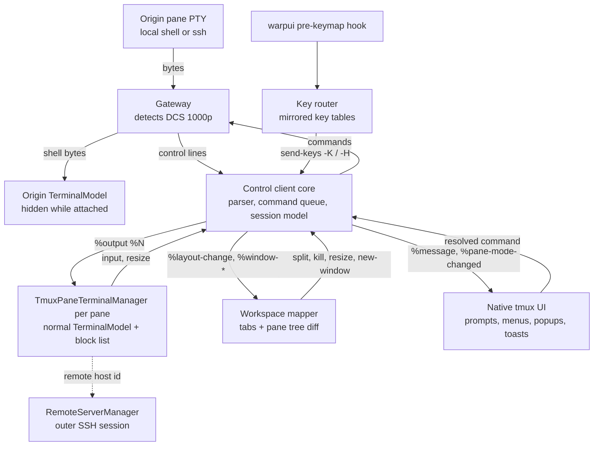
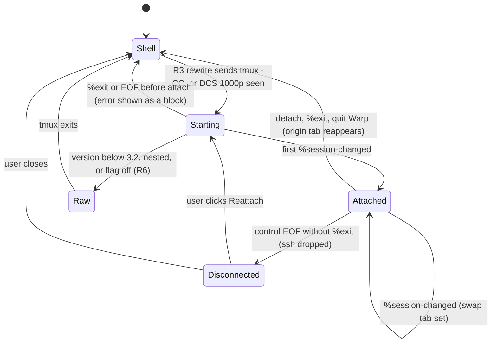
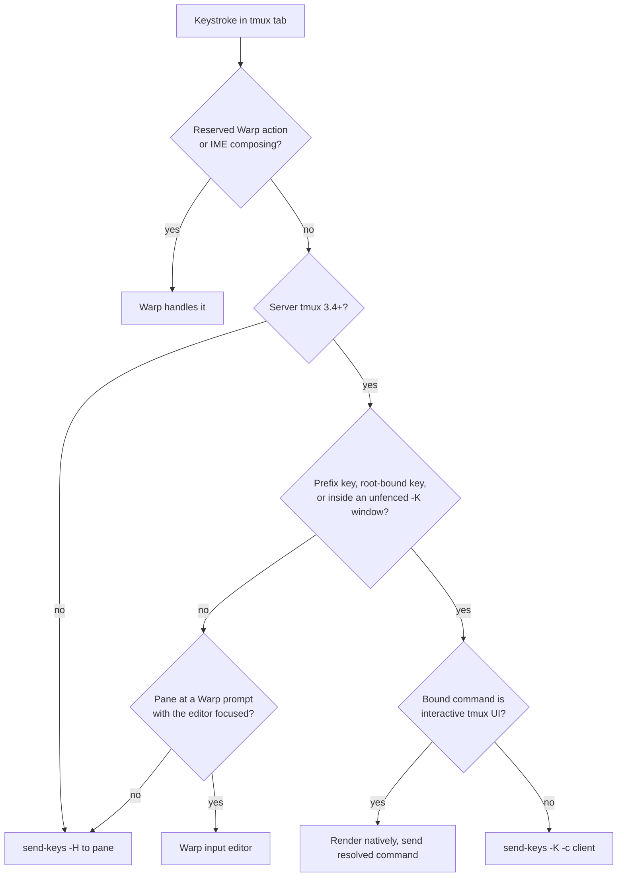
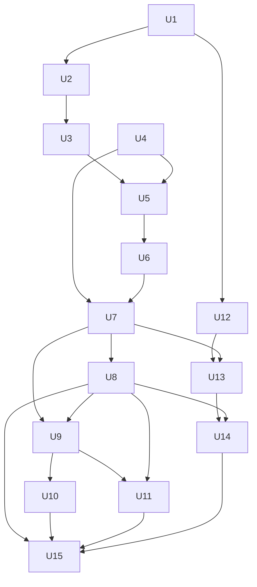

# Native tmux in Warp - Plan

## Goal Capsule

- **Objective:** A tmux user can run tmux in Warp, locally or over SSH, and keep every Warp feature in every pane while keeping tmux's persistent sessions and their own tmux keybindings.
- **Means:** A fork of `warpdotdev/warp` that implements tmux control mode (`tmux -CC`), building on upstream spec PR #14864 and reusing the protocol pieces of prototype PR #15629 (KTD1, KTD2), kept close enough to upstream to merge back.
- **Target repo:** the user's fork of `warpdotdev/warp`. All file paths in this plan are relative to that repo's root. Move this plan into the fork's `docs/plans/` once it is cloned.
- **Product authority:** This Product Contract, then the Planning Contract's KTDs on mechanism. Upstream spec PR #14864 is adopted as the baseline, and the deltas recorded here override it.
- **Execution profile:** Deep, phased (Phases A–F under Implementation Units). Each unit lands as its own commit behind the feature flag, so the fork stays usable daily throughout.
- **Stop conditions:** Stop and ask if U1 shows the fork cannot be built or run locally. Stop and ask if evidence shows tmux 3.4's key evaluation cannot honor bindings from a control client (KTD5). Stop and ask after U14's popup experiment (Outstanding Questions). Do not change product behavior in the Product Contract without the user.
- **Who finishes:** The user, or `ce-work` on the user's behalf, in the user's fork. Upstream submission is a separate, user-initiated step (U15 prepares it; nothing is pushed upstream automatically).
- **Open blockers:** None block planning. Whether a self-built client can use Warp's hosted AI is an untested assumption that U1 checks.

---

## Product Contract

### Summary

The fork makes tmux a backend for Warp's own UI: tmux windows become Warp tabs and tmux panes become Warp splits, locally and over SSH. Blocks, AI, the file explorer and code review work in every pane by default. Inside a tmux-backed tab, the user's tmux keybindings behave exactly as they do in plain tmux.

### Problem Frame

Running tmux inside Warp today turns Warp into a plain terminal. tmux draws its own text interface, so Warp can no longer see individual commands. Blocks, the input editor, completions, AI, the file explorer and the code review panel all disappear at once.

tmux users depend on it for three things Warp does not replace: sessions that survive closing the app or a dropped SSH connection, picking up exactly where they left off on a remote machine (including tmux-resurrect restores), and years of muscle memory in tmux bindings (`ctrl+b 1`, vim-style pane movement). Today they must choose between Warp's features and tmux.

Upstream knows about this. The tracking issue is #8492 (originally #42, from 2021). The May–June 2026 roadmap (#9233) lists "Tmux control mode" under "Seeking community drivers." There is an open spec PR (#14864) and an unmerged prototype PR (#15629), but nothing on master.

### Key Decisions

- **tmux control mode, keeping tmux as the session layer.** Warp renders tmux sessions natively instead of replacing tmux with Warp-owned persistent sessions. This keeps tmux-resurrect, other tmux clients and existing sessions working. Governs R1–R6. (session-settled: user-approved — chosen over Warp-native persistent sessions without tmux: the user values tmux itself, its plugins and existing sessions)
- **A fork that aims to merge upstream.** The fork is for daily use but follows the upstream spec and keeps every behavior that departs from it switchable. Governs R21, R22. (session-settled: user-approved — chosen over a personal-only fork and a publicly distributed fork: avoids maintaining a large Rust fork forever and the work of release builds)
- **Plain `tmux` commands go native automatically.** Typed `tmux`, `tmux a`, `tmux new -s …` become native without a click, and a setting turns this off. This departs from upstream's "never flip without a click." Governs R3. (session-settled: user-approved — chosen over a one-click convert banner and over `-CC`-only opt-in: the user's habit is typing `tmux`)
- **Warp features on by default in tmux panes.** Warp sets up its shell integration in panes itself, and a tmux plugin covers shells Warp did not start. This departs from upstream invariant #12 (blocks opt-in). Governs R7–R10. (session-settled: user-approved — chosen over plugin-only (pure upstream opt-in) and Warp-injection-only: neither alone covers both zero-setup use and resurrect-restored or other-client panes)
- **Full feature parity over SSH in v1.** Remote tmux panes get blocks, AI, file explorer and code review. Governs R11–R13. (session-settled: user-approved — chosen over local-first and over remote-without-file-tools: remote reattach is half the user's daily workflow)
- **The attached server's tmux bindings are honored.** Bindings come from the tmux server Warp is attached to, so remote machines use their own config. Governs R14–R17. (session-settled: user-approved — chosen over forwarding keys after the prefix and over remapping to Warp shortcuts: preserves muscle memory unchanged)
- **tmux bindings beat Warp shortcuts inside tmux tabs.** Governs R18, R19. (session-settled: user-approved — chosen over Warp-wins-with-tmux-fallback and over prefix-only: root-table bindings like vim-tmux-navigator's `ctrl+h/j/k/l` must work)
- **Converted sessions open in the current window and the origin tab hides.** Governs R23, R24. (session-settled: user-approved — chosen over a dedicated window per session and over the origin tab becoming window 1: keeps the user in one window and gives detach an obvious place to land)
- **Quit and window-close detach; tab and pane close kill.** Governs R25. (session-settled: user-approved — chosen over "everything detaches" and "ask each time": quitting must never destroy sessions, while cmd+W keeps meaning "close this")
- **tmux prompts, menus and popups render natively, popups included.** Governs R26. (session-settled: user-approved — chosen over "prompts now, popups later" and "block and notify only": popup-driven plugins are part of the user's tmux workflow)
- **Warp never types into a shared pane on its own.** While a plain client is attached, panes Warp did not create rely on the plugin or R8's action. Governs R7, R10. (session-settled: user-approved — chosen over always typing the setup command and over plugin-only: typed setup echoes to every attached client, but zero-setup coverage should stay when Warp is alone)
- **tmux tabs are marked, and new-tab stays in tmux.** Governs R28. (session-settled: user-approved — chosen over a marker with plain new tabs and over no marker: sessions on several hosts must be distinguishable, and new tabs inside tmux should be tmux windows)
- **Notices have fixed surfaces.** Governs R29. (session-settled: user-approved — chosen over toasts for everything and over leaving it to implementation: persistent states and long key lists need surfaces that stay visible)

### Actors

- A1. The tmux user: works in Warp locally and over SSH and has an existing `~/.tmux.conf` and tmux plugins.
- A2. The tmux server: local or remote. It owns sessions, windows, panes, key tables and plugins such as tmux-resurrect.
- A3. Other tmux clients: plain terminals or scripts attached to the same session, which can create or change panes while Warp is attached.
- A4. Warp's SSH extension helper on the remote host: provides remote filesystem access for the file explorer and code review.

### Requirements

**Native sessions (baseline from #14864)**

- R1. tmux windows render as Warp tabs and tmux panes as Warp splits, kept in sync in both directions. This adopts success criteria 1–11 and 13–19 of `specs/GH8492/product.md` in PR #14864, as amended by R3 and R7.
- R2. The user can start a new session or attach to a running one from Warp's UI, which lists running sessions on the current host.
- R3. Typing `tmux`, `tmux attach` / `tmux a`, `tmux new` (with any session name or flags except `-d`) or `tmux -CC` in a Warp pane, locally or inside an SSH session, opens that session natively without a click. Other subcommands (`tmux ls`, `kill-*`, `source`, anything piped or redirected) run unchanged. A setting turns automatic conversion off and restores the raw tmux screen.
- R4. Closing Warp or detaching leaves the session and its processes running. Reattaching restores the same tabs and panes.
- R5. Server-side tmux plugins, including tmux-resurrect and tmux-continuum, keep working unmodified. This includes continuum's periodic autosave while Warp is the only attached client.
- R6. If a pane's tmux command cannot go native (tmux older than the supported version, nested tmux, unknown flags), Warp falls back to the raw tmux screen and says why. The session is never broken.

**Warp features in every pane**

- R7. Every new shell pane in a session Warp is attached to gets Warp's shell integration (blocks, input editor, completions, AI) with no user setup, however the pane was created: from Warp's UI, a tmux binding, or another client (A3). Exception: while a plain tmux client is also attached, a pane Warp did not create gets integration only through the R9 plugin, and otherwise shows R8's action.
- R8. When attaching to an existing session, panes whose shells started without integration stay plain and offer a one-click "Warpify this pane."
- R9. A tmux plugin, installable with TPM or a single config line, makes every shell tmux starts without Warp's help Warp-ready: resurrect restores, continuum, scripts, and splits made by other attached clients. Those shells have Warp features whenever Warp is attached or later attaches.
- R10. Plain tmux clients attached to the same session never see Warp's integration markers or other visible side effects from R7 or R9.

**Remote (SSH)**

- R11. In a remote tmux session, panes get blocks, input editor, completions and AI, as in R7.
- R12. In a remote tmux session, the file explorer and code review show the remote host's filesystem for the focused pane's working directory, using Warp's SSH extension connection to the same host (A4).
- R13. If the SSH extension helper cannot run on the host, the session still works natively with blocks and AI, and Warp tells the user which features are unavailable on that host.

**Keybindings**

- R14. Warp uses the prefix and key tables of the tmux server it is attached to, so local and remote sessions each follow their own server's config with no file syncing.
- R15. Prefix bindings (for example `ctrl+b 1`, `ctrl+b %`) do in Warp what they do in plain tmux, and the result shows up as native tab and split changes.
- R16. Root-table and conditional bindings (`if-shell`, for example vim-tmux-navigator's `ctrl+h/j/k/l`) behave exactly as in plain tmux: they move panes in a shell pane and reach vim in a vim pane.
- R17. Binding changes on the server (for example `tmux source-file`) take effect without reattaching.
- R18. Inside a tmux-backed tab, any key bound in the attached server's key tables goes to tmux handling, even when Warp or Warp's input editor also uses it. Keys tmux does not bind go to Warp. Exception: Warp's reserved actions (command palette, quit, new window, settings, and a configurable escape-hatch chord) and IME composition always stay with Warp.
- R19. The first time a user's tmux bindings shadow Warp shortcuts or editor keys, Warp shows a one-time notice listing the shadowed keys and stating that reserved keys (R18) always stay with Warp.
- R20. Pane navigation over SSH that depends on the remote server (R16) stays usable on a typical home or office connection, and Warp shows feedback while a binding is in flight.
- R27. On a tmux server older than 3.4, sessions still render natively, but tmux bindings are not honored on that server and Warp says so once per server.

**Session lifecycle**

- R23. When a typed command converts, the session's windows open as tabs in the current Warp window at the origin tab's position, and the origin tab hides while attached.
- R24. On detach or server exit, the origin tab reappears with a line naming the session and how it ended, followed by the shell prompt (still inside the SSH session when remote).
- R25. Quitting Warp or closing a Warp window detaches without killing anything, and Warp's running-process quit warning ignores tmux panes. Closing a tmux tab kills that tmux window, and closing a split kills that pane, each with a confirmation when a process other than an idle shell is running.
- R28. A tmux-backed tab carries a small tmux marker, and its tooltip names the session and host. Inside a tmux tab, cmd+T and the tab-bar `+` create a tmux window, and the `+` menu also offers a plain local tab.
- R29. tmux notices use fixed surfaces. Persistent conditions (R13 unavailable features, R27 old tmux, "tmux not responding") show as a banner on the affected tabs. The R19 shadowed-keys notice is a dismissible banner with a "Show keys" link. The R6 fallback reason is a line in the terminal. R20's in-flight indicator is a spinner on the tab title. Each "once" notice is remembered per server across restarts.

**tmux interactive UI**

- R26. Bindings that open tmux interactive UI behave as in plain tmux, drawn natively: `confirm-before` and `command-prompt` as Warp prompts, `choose-tree`/`choose-session` as Warp's session and window picker, `display-menu` as a native menu, `display-popup` as a floating Warp pane running the popup's command, and `display-message` as a toast. No binding may leave an invisible prompt waiting for input.

**Upstream compatibility**

- R21. Each behavior that departs from upstream spec #14864 (R3 automatic conversion, R7/R9 default-on integration, R18 key precedence) is a separate setting, so upstream can merge the core without them.
- R22. The whole feature stays behind upstream's planned `terminal.tmux_control_mode` setting and feature flag. Turning it off restores today's behavior.

### Key Flows

- F1. Daily local session
  - **Trigger:** A1 opens Warp and types `tmux a`.
  - **Steps:** Warp attaches natively. The session's windows appear as tabs and panes as splits. Each pane has blocks and AI. `ctrl+b 2` switches to tab 2. `ctrl+h` moves left between shell panes. A1 quits Warp at night.
  - **Outcome:** The next morning `tmux a` restores the same tabs, panes and running processes.
  - **Covered by:** R3, R4, R7, R15, R16
- F2. Remote reattach
  - **Trigger:** A1 runs `ssh box`, then `tmux a`.
  - **Steps:** Warp attaches natively to the remote server and reads its bindings. The SSH extension connects to the same host. The file explorer shows the remote working directory. A1 reviews a diff in code review.
  - **Outcome:** Same experience as F1, against the remote host's files.
  - **Covered by:** R3, R11, R12, R14
- F3. Restore after a reboot
  - **Trigger:** The remote host reboots. tmux-continuum restores sessions via tmux-resurrect before A1 reconnects.
  - **Steps:** The plugin (R9) has made restored shells Warp-ready. A1 reconnects and attaches.
  - **Outcome:** Restored panes have blocks and AI with no manual Warpify.
  - **Covered by:** R5, R9, R11

### Acceptance Examples

- AE1. **Covers R16, R18.** Given vim-tmux-navigator is configured, when A1 presses `ctrl+h` in a pane at a shell prompt, focus moves to the left pane. When A1 presses `ctrl+h` in a pane running vim, vim receives it and moves between vim splits. Warp's editor backspace never fires.
- AE2. **Covers R7, R9, R10.** Given a coworker is attached to the same session from a plain terminal, when they press `prefix %`, the coworker's terminal shows a normal shell with no stray text or escape sequences. With the R9 plugin installed, Warp shows the new split with blocks. Without it, Warp shows the split with a "Warpify this pane" action.
- AE3. **Covers R8.** Given A1 attaches to a session started last week in another terminal, existing panes show plain output with a "Warpify this pane" action, and panes opened after attaching have blocks immediately.
- AE4. **Covers R13.** Given a locked-down host where the SSH extension helper cannot install, when A1 attaches to tmux there, tabs, splits, blocks and AI work, and a notice says the file explorer and code review are unavailable on this host.
- AE5. **Covers R3, R6.** Given automatic conversion is on, when A1 types `tmux` inside a pane that is already inside tmux (nested), Warp shows the raw tmux screen with a note that nested tmux is not supported natively.
- AE6. **Covers R17.** Given A1 edits `~/.tmux.conf` to rebind the prefix to `ctrl+a` and runs `tmux source-file ~/.tmux.conf`, the next `ctrl+a 1` switches tabs without reattaching.
- AE7. **Covers R3.** Given automatic conversion is on, `tmux ls` prints the session list as a normal block, `tmux new -d -s bg` creates a background session without converting, and `tmux a -t nope` shows tmux's error as a normal block with no empty native tab left behind.
- AE8. **Covers R23, R24, R25.** Given A1 typed `tmux a` in tab 3, the session's two windows appear as tabs 3 and 4 and the origin tab is hidden. When A1 quits Warp and reopens it, the session is still running. When A1 presses `prefix d`, the tmux tabs close and the origin tab returns showing "[detached from work]" and a prompt.
- AE9. **Covers R26.** Given `prefix x` is bound to `confirm-before kill-pane`, pressing it shows a native "kill-pane? (y/n)" prompt. Pressing `n` leaves the pane alone, and the next keystroke goes to the pane as normal. Given a binding runs `display-popup -E 'fzf'` directly, pressing it opens a floating Warp pane running the picker, which closes when the picker exits.
- AE10. **Covers R27.** Given A1 attaches over SSH to a host running tmux 3.2, the session renders natively, `prefix` keys reach the shell as plain input, and a one-time notice says tmux bindings need tmux 3.4 or newer on that host.

### Scope Boundaries

**Deferred for later**

- Native copy-mode parity (tmux copy-mode remains the fallback), per #14864's non-goals.
- Nested tmux and Windows hosts.
- A session dashboard for listing and killing sessions beyond R2's attach menu.
- Catching `tmux` launched by wrapper tools (tmuxinator, sesh, tmuxp) or scripts. Those still convert when they pass `-CC` themselves.

**Outside this work's identity**

- Replacing tmux with Warp-owned persistent sessions (roadmap item "Persistent sessions locally and over ssh").
- Zellij or GNU screen support (#3935).
- A publicly distributed fork: release builds, signing, notarization, auto-update.
- Reproducing tmux's status bar visually. Window names come through as tab titles under R1.

### Dependencies / Assumptions

- **Self-built AI access is unverified.** Warp's FAQ says the agent harness "runs server-side and isn't open in this repo," and hosted-model agents need Warp's backend. U1 checks whether a self-built client can sign in to production Warp. If it cannot, AI parity (R7, R11) holds only once upstream merges, and the fork's daily build ships without AI.
- **The SSH extension helper is the remote filesystem source.** Warp's SSH docs say the remote "server" reads and writes files, runs git and backs the remote file tree and code review. R12 depends on pairing it with the tmux attach (KTD9).
- **Upstream receptiveness.** R3, R7/R9 and R18 contradict upstream decisions in #14864 (invariant #12, "never flips without a click"). If upstream declines them, the fork carries them, which R21 limits to toggleable deltas.
- **Contribution process.** Upstream PRs need a signed CLA and follow a spec-first flow under `specs/<issue>/`, so this contract's deltas will need a spec update to #14864 or a follow-up spec (U15).
- **tmux version.** Native rendering needs tmux 3.2+ for flow control and degrades below it, per #14864. Honoring bindings needs 3.4+ (R27). The user runs tmux 3.7c locally.

### Outstanding Questions

**Deferred to Planning**

None remain. The planning questions this contract raised are answered by KTD1–KTD13 in the Planning Contract.

**Returns to the user during implementation**

- Do script-opened popups (tmux-fzf's `run-shell` → `fzf-tmux -p` → `display-popup`) stay in R26's scope? U14 begins with an experiment on tmux 3.7c that records what tmux does with such a popup when Warp's control client is the only client, then brings the result to the user before the popup work proceeds. Until then, R26 is committed only for interactive UI bound directly to a key.

### Sources / Research

- Upstream spec: PR #14864, `specs/GH8492/product.md` and `specs/GH8492/tech.md`.
- Prototype: PR #15629 "Dedicated tmux-owned Warp window for control mode" (open, unmerged, base `c2e4ee4`, 251 commits behind master on 2026-10-09).
- Tracking: issues #8492, #42, #5687, #12329. Roadmap #9233 ("Seeking community drivers: Tmux control mode").
- tmux control mode: https://github.com/tmux/tmux/wiki/Control-Mode, the tmux CHANGES file, and `cmd-send-keys.c`, `server-client.c`, `cmd-display-menu.c`, `status.c` in tmux source.
- Prior art: iTerm2 tmux integration docs (https://iterm2.com/documentation-tmux-integration.html); Ghostty control-mode PRs #11608 (DCS parser and high bytes), #11395 (block framing), #12076 (octal decoding), #14276 (input via `send-keys`).
- Build: `./script/bootstrap` then `./script/run`. Rust 1.92 (`rust-toolchain.toml`), full Xcode on macOS. License AGPL v3, with `warpui`/`warpui_core` under MIT. Hosted-server limits are in `FAQ.md`.

**Product Contract preservation:** changed: R3 (excluded `new -d` and non-attaching subcommands), R5 (named continuum autosave), R7 and AE2 (no typing into a pane shared with a plain client), R9 (covers other clients' splits), R18 and R19 (reserved keys stay with Warp), AE9 (popup example bound directly). Added R23–R29. Every change is a user decision from planning or document review. These are product decisions the user made during planning (Key Decisions above) or a clarification of R3. No existing requirement was weakened.

---

## Planning Contract

### Key Technical Decisions

- KTD1. **Rebuild on master and reuse only the prototype's protocol layer.** Port PR #15629's control-mode parser, layout parser, octal decoder and hex `send-keys` encoder (with fixes) into a fresh branch off current master. Rebuild the transport, pane rendering, workspace mapping and injection. The prototype's hidden-window presentation, alt-screen grid with the editor hidden, and plain `send-keys` input each contradict R7, R18 and R23. It is also 251 commits stale in the UI files it touches most.
- KTD2. **Same-PTY gateway.** The control stream is read from the pane where `tmux -CC` started, as the prototype does, so local and `ssh host` sessions share one path (R11) with no new SSH plumbing. Detection runs only while `terminal.tmux_control_mode` is on and only scans for the `ESC P 1000p` entry sequence, so other PTYs pay one byte comparison.
- KTD3. **Each tmux pane is an ordinary Warp terminal fed by `%output`.** A new `TmuxPaneTerminalManager` takes its model and lifecycle pattern from `app/src/terminal/shared_session/viewer/terminal_manager.rs` (a network-fed pane with blocks) and only its `PtyController<Sender<Message>>` wiring from `app/src/terminal/remote_tty/` (a cfg-gated dogfood stub that hardcodes zsh, discards query replies and parses on the UI thread). Input becomes `send-keys -H`, resize becomes `refresh-client -C @window:WxH`, and terminal query replies go back through `send-keys -H`. `Message::Shutdown` never maps to `kill-pane`, because `shutdown_pty` fires whenever a Warp pane is dropped, including window-close and quit. Only an explicit close action (R25) sends kill. Backend creation gets a runtime branch next to the compile-time `cfg_if!` in `app/src/pane_group/mod.rs`.
- KTD4. **Native tabs come from the snapshot-restore path, with a non-persisted leaf type.** A tmux layout string converts to a `PaneNodeSnapshot` whose leaves use a new `LeafContents::TmuxPane { pane_id }` variant, opened through `Workspace::add_tab_with_pane_layout` (`app/src/workspace/view.rs`). That variant creates a `TmuxPaneTerminalManager` instead of a local PTY and reports `is_persisted() = false`. `save_app_state` skips whole tmux tabs, so they never come back as local shells after restart, and it persists the hidden origin tab as visible. The origin tab stays in `Workspace.tabs` with a non-persisted `hidden_for_tmux` flag on `TabData`, and every user-facing tab enumeration skips hidden tabs: the tab bar, vertical tabs, cmd+1–9, next/previous tab, close-other-tabs and drag targets. Later `%layout-change` events apply as an idempotent diff keyed by pane id (`%N`). tmux's layout is the source of truth for geometry.
- KTD5. **Keys route through tmux's own key evaluation, in one ordered queue.** Warp mirrors the attached client's prefix, `prefix2` and root table from `list-keys -F`. A key goes to `send-keys -K -c <client>` (tmux 3.4+) when it is the mirrored prefix or `prefix2`, matches a root binding, or arrives while the client may be in a non-root table, so tmux resolves tables, `if-shell`, repeat and prefix state itself. Control mode never reports key-table changes, so after each `-K` key Warp keeps routing every key through `-K` until that key is acknowledged and a fence (`display-message -p -c <client> '#{client_key_table} #{pane_id}'`) reports the client back in `root`. That covers `bind -r` repeat, `switch-client -T` tables and pane focus changing under the next keystroke. Outside that window, a key goes to Warp's input editor when the focused pane is at a Warp prompt with the editor focused, and otherwise to the pane as `send-keys -H` without a round trip. All keys share one outbound queue in send order. Below 3.4, every key uses `send-keys -H` and R27's notice shows. Implements R14–R18 and R27 under the "bindings honored" and "tmux wins" Key Decisions.
- KTD6. **A pre-keymap intercept hook in warpui-core, plus the macOS menu path.** `AppContext::handle_window_event` (`crates/warpui_core/src/core/app.rs`) gets one generic hook: before `dispatch_keystroke`, the focused view's responder chain may claim a raw keystroke. A claim resets any pending multi-key match in `keystroke_matcher`. The hook is skipped while `key_bindings_enabled(window)` is false (the keybinding recorder). On macOS, keys bound to custom menu actions are routed to NSMenu in `performKeyEquivalent` (`crates/warpui/src/platform/mac/objc/window.m`) before they reach the app, so that path must ask the same claim question. Reserved Warp actions (command palette, quit, new window, settings, plus a configurable escape-hatch chord) are never claimable. The app-level `EventMunger` was the smaller alternative but cannot scope a claim to the focused view. The hook ships as its own commit with no tmux references, so it can go upstream alone.
- KTD7. **Shell integration through a self-contained launcher, and typing only when Warp is alone.** Warp's local bootstrap is two-phase: the shell starts minimal (`zsh -g --no-rcs`, `--rcfile` for bash, `--init-command` for fish, in `crates/warp_terminal/src/local_tty/shell.rs`), emits `InitShell`, and Warp then writes the bootstrap body into the PTY (`PtyController::write_bootstrap_script_to_shell`). In a tmux pane that write would be typed into a shared pane, so the launcher (`warp-shell.sh`) is a new single-phase path instead. It sources the complete marker-only bootstrap (KTD8) from files installed beside it, derives its session id per KTD8's token rule, and announces itself bootstrapped. Tmux pane `PtyController`s never call `write_bootstrap_script_to_shell`. On each attach Warp installs the launcher and bootstrap files to a versioned path on the tmux server's host (for example `~/.cache/warp/tmux/<hash>/`) through `run-shell` over the control channel, verifies a checksum, and uses that path for every pane it creates (`split-window`, `new-window`, `new-session` from Warp UI or R3). If installation fails, Warp-created panes start with the default shell and fall to the typed path below. For any pane without the launcher, Warp types the init-subshell command only when `list-clients` shows no plain client attached, `pane_current_command` is a known shell, and `#{alternate_on}` is 0, after the pane first goes idle. Otherwise the pane gets R8's action. A pre-existing pane already carrying verified integration options (KTD8) is registered as integrated; other pre-existing panes get R8's action.
- KTD8. **The tmux plugin is a `default-command` wrapper around the same launcher, and integration is trusted through a per-server token.** `warp.tmux` sets `default-command` to the KTD7 launcher in marker-only mode. That mode emits Warp's DCS/OSC markers but leaves PS1 and the line editor alone, and plain tmux clients drop unknown DCS/OSC, which keeps R10. The launcher saves and restores any existing `default-command`. Warp rejects hooks whose session id it did not register (`validate_hook_session_id` in `crates/warp_terminal/src/model/ansi/mod.rs`), and that check stays on for tmux panes. Instead, Warp or the plugin stores a random per-server token in the `@warp-hook-token` user option. The launcher derives each pane's session id as an HMAC of the token and the pane id, and records `@warp_session_id` and `@warp_shell` as pane user options. On attach, Warp reads the token and those options with `list-panes -F` and registers only session ids that verify. Pre-existing panes bootstrapped while Warp was detached (F1's morning reattach, F3's restore) then show blocks from their next prompt, and program output printing a forged hook is still rejected. The plugin install hint covers hosts where Warp's own install (KTD7) is not possible. The launcher is never inlined into `#{pane_start_command}`, where it would show in `ps` and choose-tree. U9 builds marker-only mode and proves it invisible to plain clients before the plugin or the typed path is enabled.
- KTD9. **Remote panes map to the outer SSH session's host in the app layer.** tmux panes do not become `RemoteServerManager` sessions. Sessions are created only by `connect_session`, and `deregister_session` kills the ssh child and ControlMaster (`crates/remote_server/src/manager.rs`), so registering panes would risk tearing down the connection. Instead the tmux layer maps each pane to the origin session's `HostId` and uses the existing host-scoped calls (`client_for_host`, `send_host_scoped_request`). The connection's lifetime stays with the hidden origin pane's `RemoteServerController`, which must not deregister while attached. Pane working directories then resolve as `LocalOrRemotePath::Remote` and the coding panel enables, explicitly, because tmux pane views skip `wire_up_remote_server_controller_with_view`. A pane whose OSC 7 host differs from the paired host shows "explorer unavailable for this pane" rather than the wrong filesystem.
- KTD10. **tmux interactive UI is intercepted before it reaches tmux.** Before routing a key through `send-keys -K`, Warp looks up its bound command (from the KTD5 mirror). If that command is `confirm-before`, `command-prompt`, `display-menu`, `display-popup`, `choose-tree`/`choose-session` or `display-panes`, Warp renders it natively and sends the resulting command over the control channel. tmux expands formats (`display-message -p`), so Warp never hand-parses tmux quoting. For a popup, Warp runs its command in a temporary tmux window and shows that pane as a floating Warp pane, closing it on exit. `%message` becomes a toast, and `%pane-mode-changed` into copy or choose mode shows a "tmux mode — press q" overlay so the pane never looks frozen. Implements R26.
- KTD11. **The continuum autosave stand-in lives in the client.** On attach, Warp reads `@continuum-save-interval` and the resurrect save script path. If both are present, Warp runs the save with `run-shell -b` on that interval while it is attached, skipping when a plain client is also attached (that client's status line already drives continuum). Implements R5. The control client never draws a status line, so continuum's own trigger never fires.
- KTD12. **The gateway thread splits bytes and never parses panes.** The entry detector and control parser run on raw reads before `pty_read` takes the origin model's lock (`crates/warp_terminal/src/local_tty/event_loop.rs`). Pane payloads go to a bounded queue per pane, parsed on a background executor. A queue past its high-water mark sends `refresh-client -A '%N:pause'` and resyncs on resume, in addition to tmux's time-based `pause-after`. One busy pane then cannot delay replies or other panes.
- KTD13. **The control channel has health checks.** At most four `send-keys -K` commands are unacknowledged at once, and the rest wait client-side. A queued key older than 1 s is dropped only when it is a root-table key whose mirrored command is pane or window navigation (`select-pane`, `select-window`, or `if-shell` wrapping them), per R20. Keys sent while the client is in a non-root table or a pane mode are never dropped. Any command unanswered after 3 seconds shows a "tmux not responding" banner on the session's tabs, which covers a binding stuck in a synchronous `if-shell` or `run-shell`. A parser desync drops the session to Disconnected with Reattach and keeps the raw bytes in a debug log instead of feeding garbage to panes. Gateway EOF signals the control core, which marks every tab Disconnected. Server-wide hooks Warp installs (`after-bind-key`) carry a Warp tag, and every attach clears stale tagged hooks left by a crashed Warp.

### High-Level Technical Design

Component shape. The protocol core is pure and lives in `warp_terminal`; everything that touches UI lives in `app`.

Session lifecycle in the origin pane (R3, R6, R23–R25):

Key routing for one keystroke in a tmux tab (KTD5, KTD6, KTD10):

Paste bypasses this flow entirely. It goes to the input editor at a Warp prompt, and otherwise to the pane as literal text with bracketed paste when the pane enabled it.

### Assumptions

- tmux forwards Warp's DCS hook bytes (`ESC P $ d … ESC \`) unchanged inside `%output` to control clients and drops them for plain clients. This was observed for OSC 133, OSC 7, OSC 1337 and DCS on tmux 3.7c. U2's transcript fixtures and U9's live test confirm it for Warp's exact hooks.
- `send-keys -K -c` behaves for a control client as observed on 3.7c, prefix state included. The ordering fix for nested `send -K` inside bindings landed only in 3.8. Bindings that themselves call `send -K` may reorder on 3.4–3.7, which is accepted.
- A self-built client can run without `WITH_LOCAL_SERVER=1` for terminal features. U1 confirms this and the AI question.

### Implementation Constraints

- Follow AGENTS.md: sibling `*_tests.rs` files via `#[path]`, `cargo nextest`, clippy with `-D warnings`, and a matching Command Palette toggle for every toggleable setting.
- Every new behavior is gated by `FeatureFlag::TmuxControlMode` and the `terminal.tmux_control_mode` setting (R22). Each delta has its own setting (R21).
- Do not touch the deprecated tmux SSH wrapper tombstones (`warpify/settings.rs`, `ssh_tmux_deprecation_banner.rs`). That keeps upstream rebases clean.
- One lock order everywhere: control core, then pane model. The gateway thread never locks a pane model, and pane VT parsing never runs while the origin model is locked (KTD12). The prototype's nested gateway→bridge→pane locking is a known bug.
- Only an explicit user close (R25) sends `kill-pane` or `kill-window`. Dropping a pane, closing a window and quitting never do (KTD3).

### Alternatives Considered

- **Rebase the whole prototype.** Rejected (KTD1). Its rendering, input and window model each conflict with a requirement, and rebasing 32 shared files across 251 commits costs more than rebuilding the UI layer on current master.
- **Mirror tmux key tables and evaluate bindings locally.** Rejected for 3.4+ servers (KTD5). Warp cannot run `if-shell` server-side conditions or track tmux's prefix and repeat state faithfully. It remains the reason R27's fallback is "no bindings" rather than "approximate bindings."
- **Environment-only injection through server-wide `default-command` set by Warp itself.** Rejected as the zero-setup path (KTD7). Changing a server-wide option on attach affects plain clients' new panes and outlives a crashed Warp. Warp leaves that to the opt-in plugin (KTD8), where the user chose it.
- **A dedicated control socket per Warp (`-L warp-control-v1`, as in the prototype).** Rejected. It hides the user's existing sessions and resurrect state (R2, R5).

### Sequencing

Phase A (U1–U3) has no UI and can merge first, and U12 can land any time after U1. Phase B (U4–U8) makes sessions native with plain panes. Phase C (U9–U10) needs U7 and U8, because Warp-created panes start through the launcher. Phase D (U11) needs Phase C's bootstrapped panes. Phase E's U13 needs U7 and U12, and U14 also needs U8's session menu. U15 closes out.

### System-Wide Impact

- **Keyboard dispatch for the whole app** changes through KTD6's hook. It must be a no-op for every view that does not claim keys, and is covered by existing keybinding integration tests.
- **The local PTY read loop** gains a gated scan (KTD2). With the flag off it must be byte-for-byte identical in behavior.
- **Quit flow:** R25 changes which panes count as running processes.
- **Remote server connections:** KTD9 keeps tmux panes out of `RemoteServerManager`'s session table. The hidden origin pane owns the connection, so its `RemoteServerController` must stay alive and registered for the whole attach.
- **Session restore:** tmux tabs are never written to saved app state (KTD4). The hidden origin tab is saved as visible, so a crash restores a normal shell tab, not phantom tmux tabs.
- **Undo-close:** closing a tmux pane or tab has already sent a kill, so tmux panes and tabs are exempt from `UndoCloseStack`.
- **Quit flow:** R25 changes which panes count as running processes. The event loop's `Shutdown` handling currently returns before queued writes flush, so a tmux-tagged shutdown flushes the detach line first. If the process is killed before the flush, tmux treats the dropped client as detached anyway.
- **Hidden origin tab lifecycle:** Warp's pane-exit and auto-close behavior must not remove the hidden origin tab while attached, because R24 lands there and Reattach reuses it.
- **Failure propagation:** one slow pane, a hung command, a parser desync and gateway EOF each have a defined outcome (KTD12, KTD13). None of them may freeze the window or tabs outside the session.

### Risks

| Risk | Mitigation |
|---|---|
| Upstream rejects the warpui-core hook (KTD6) | It is generic and tmux-free. If rejected, the fork carries one small diff in one function. |
| Warp's bootstrap changes the prompt or line editor in a way plain clients see, which would make R7 and R10 conflict for every Warpified pane | U9 builds the marker-only mode (KTD8) first and proves it with a live two-client test before any injection path is enabled. If it cannot be made invisible, R7 falls back to R8's action whenever any plain client is attached, and the user decides whether that is acceptable. |
| One slow or chatty pane freezes every tab in the session | KTD12: split bytes before the origin lock, per-pane bounded queues, high-water pause. |
| A binding stuck in a synchronous `if-shell` or `run-shell` blocks all replies | KTD13: cap unacknowledged `-K` commands and show a "tmux not responding" banner after 3 seconds. |
| Warp's server-wide `after-bind-key` hook outlives a crashed Warp | KTD13: tag Warp's hooks and clear stale tagged ones on every attach. |
| Keys bound to macOS menu items never reach the claim hook | KTD6: the `performKeyEquivalent` path asks the same claim question. U12 tests a claimed key that is also a menu shortcut. |
| `display-menu` and blocking `command-prompt` hang the control client's queue if they ever reach tmux | KTD10 intercepts them. As a backstop, U14 sends `-b` variants and adds a 2-second watchdog that cancels with `send-keys -K Escape` and logs. |
| The fork drifts from fast-moving master | Weekly rebase. Keep new code in new files under `app/src/terminal/tmux/` and `crates/warp_terminal/src/tmux/`, with shared-file edits kept small. |
| A self-built client cannot use hosted AI | Surfaced by U1 before any feature work. Everything except AI in panes still ships. |
| A plain client at a smaller size shrinks every native tab (tmux `window-size smallest`) | Show tmux's layout faithfully with a gray margin, per #14864's edge cases. Do not change the user's `window-size`. |

---

## Implementation Units

| U-ID | Title | Key files | Depends on |
|---|---|---|---|
| U1 | Fork bootstrap and build smoke | `script/`, `FAQ.md` | — |
| U2 | Control-mode protocol core | `crates/warp_terminal/src/tmux/` | U1 |
| U3 | Control client engine | `crates/warp_terminal/src/tmux/client.rs` | U2 |
| U4 | Feature flag and settings | `crates/warp_features/src/lib.rs`, `app/src/terminal/tmux/settings.rs` | U1 |
| U5 | Gateway transport and entry detection | `crates/warp_terminal/src/local_tty/event_loop.rs`, `app/src/terminal/tmux/gateway.rs` | U3, U4 |
| U6 | tmux pane backend | `app/src/terminal/tmux/pane_manager.rs`, `app/src/pane_group/mod.rs` | U5 |
| U7 | Workspace mapping and lifecycle | `app/src/terminal/tmux/workspace_sync.rs`, `app/src/app_state.rs`, `app/src/workspace/view.rs` | U4, U6 |
| U8 | Session entry and auto-convert | `app/src/terminal/tmux/entry.rs`, `app/src/terminal/view.rs` | U7 |
| U9 | Shell integration in tmux panes | `app/src/terminal/tmux/integration.rs`, `app/assets/bundled/tmux/warp-shell.sh` | U7, U8 |
| U10 | tmux plugin and continuum autosave | `app/assets/bundled/tmux/`, `app/src/terminal/tmux/plugins.rs` | U9 |
| U11 | Remote parity over SSH | `app/src/terminal/tmux/remote.rs`, `app/src/coding_panel_enablement_state.rs` | U8, U9 |
| U12 | warpui-core pre-keymap hook | `crates/warpui_core/src/core/app.rs`, `crates/warpui/src/platform/mac/objc/window.m` | U1 |
| U13 | tmux key routing | `app/src/terminal/tmux/keys.rs` | U7, U12 |
| U14 | Native tmux interactive UI | `app/src/terminal/tmux/native_ui.rs` | U8, U13 |
| U15 | End-to-end tests and upstream spec delta | `crates/integration/src/test/tmux.rs`, `specs/GH8492/` | U8, U10, U11, U14 |

### Phase A — Protocol core

### U1. Fork bootstrap and build smoke

**Goal:** A working local build of the fork, and an answer to whether a self-built client can use hosted AI.

**Requirements:** Goal Capsule stop conditions. Supports R7 and R11 (AI assumption).

**Dependencies:** None.

**Files:** none changed. Findings go in the plan's Dependencies / Assumptions.

**Approach:**
1. Fork `warpdotdev/warp` on GitHub and clone it. Run `./script/bootstrap --skip-common-skills`, then `./script/run`.
2. Sign in from the self-built app against production. Record whether Agent Mode works.
3. Run a plain `tmux` inside the dev build to confirm today's baseline behavior.

**Execution note:** This is environment setup; verify by running the app, not with unit tests.

**Test expectation:** none -- environment setup with no code change.

**Verification:** The dev build launches, opens a terminal, and the AI result is recorded as "works" or "blocked" in Dependencies / Assumptions.

### U2. Control-mode protocol core

**Goal:** A pure, byte-oriented parser and encoder for the tmux control protocol, ported from PR #15629 with its known bugs fixed.

**Requirements:** R1, R6, R14 (foundation). KTD1.

**Dependencies:** U1.

**Files:**
- Create: `crates/warp_terminal/src/tmux/mod.rs`, `parser.rs`, `layout.rs`, `encode.rs`, `version.rs`
- Test: `crates/warp_terminal/src/tmux/parser_tests.rs`, `layout_tests.rs`, `encode_tests.rs`, `version_tests.rs`
- Fixtures: `crates/warp_terminal/src/tmux/fixtures/*.cc` (recorded `tmux -CC` transcripts from tmux 3.2, 3.4 and 3.7)

**Approach:**
1. Port `parser.rs`, `layout.rs` and `encode.rs` from `proto` as the starting point.
2. Parse `%output` and `%extended-output` payloads as bytes, with a per-pane carry for split UTF-8. Never call `from_utf8` on a payload.
3. Frame replies by matching `%begin`/`%end`/`%error` on both timestamp and command number, not on a line prefix (Ghostty #11395). Tolerate notifications that arrive between blocks on servers older than 3.8.
4. Handle every notification in the tmux wiki list. Treat unknown `%` lines and stray idle bytes as ignorable.
5. Layout parsing verifies the checksum, caps recursion depth, and reads both the layout and the visible-layout fields (the latter for zoom).
6. `version.rs` parses `tmux -V` and `#{version}` into the native floor (3.2, which includes flow control) and one feature gate: `send-keys -K` and `list-keys -F` at 3.4.

**Patterns to follow:** `proto:crates/warp_terminal/src/tmux/parser.rs` structure. `crates/warp_terminal/src/model/ansi/dcs_hooks_tests.rs` for test layout.

**Test scenarios:**
- A `%output %3 caf\303\251` line split across two reads decodes to the UTF-8 bytes of "café" with nothing dropped.
- `%output` containing `\134` and `\033` decodes to a backslash and ESC.
- A reply payload line reading `%end not really` does not end the block, because the timestamp and command number don't match the open `%begin`.
- A `%window-renamed` notification between `%begin` and `%end` on a 3.7 transcript is delivered as a notification, and the reply is intact.
- The DCS entry `ESC P 1000p` split across reads at every byte offset is detected exactly once.
- `%exit` followed by `ESC \` in the same read as trailing shell output returns control to the shell, and the shell bytes are emitted.
- A layout `{…}` nested past the depth cap is rejected with an error rather than a stack overflow.
- A layout with a bad checksum is rejected.
- `send_keys_command` for a 300-byte paste produces three commands and reports three outgoing command numbers.
- Versions `3.2`, `3.4`, `3.7c`, `next-3.8` and `master` parse to the right gates.

**Verification:** Every fixture transcript replays through the parser with the expected event sequence, and the crate has no dependency on `app`.

### U3. Control client engine

**Goal:** A transport-agnostic state machine that sends commands, correlates replies, and keeps a model of sessions, windows and panes.

**Requirements:** R1, R4, R6, and #14864 criteria 10, 11, 14, 15 and 18 (adopted by R1). KTD1.

**Dependencies:** U2.

**Files:**
- Create: `crates/warp_terminal/src/tmux/client.rs`, `crates/warp_terminal/src/tmux/model.rs`
- Test: `crates/warp_terminal/src/tmux/client_tests.rs`, `crates/warp_terminal/src/tmux/model_tests.rs`

**Approach:**
1. Correlate commands by command number from `%begin`, not FIFO (the prototype's desync bug).
2. Run the attach handshake:
   - query the version
   - `refresh-client -f pause-after=…,wait-exit` on 3.2+
   - `list-windows` and `list-panes` with formats
   - `show -gv prefix`, `prefix2`
   - `list-keys -F` on 3.4+
3. On `%pause %N`, resume with `refresh-client -A '%N:continue'`, then resync that pane with `capture-pane`.
4. Seed history per pane with `capture-pane -p -e -J -S -<n>`. Buffer `%output` for that pane until the capture reply lands, so nothing is spliced or duplicated.
5. Request a repaint for alt-screen panes (`#{alternate_on}`) instead of seeding them.
6. Emit typed events (window added, layout changed, output for a pane, message, mode changed, exit or EOF) for the app layer.
7. Cap replies and buffered output. On overflow, resync rather than truncate.
8. Apply KTD13's health checks: the unacknowledged `-K` cap, the 3-second command timeout event, and desync → Disconnected.

**Patterns to follow:** `proto:crates/warp_terminal/src/tmux/io.rs` for the phase machine (minus FIFO correlation and the `@0`/`%0` synthesis).

**Test scenarios:**
- A paste over 128 bytes followed by `list-windows` routes the `list-windows` reply to the right request (the prototype regression).
- `%pause %2` triggers a continue for pane 2 and a resync, and output from panes 1 and 3 keeps flowing.
- `%output` for pane 4 that arrives before its `capture-pane` reply is applied after the seed, in order, with no duplicated line at the seam.
- A 3.2 server completes the handshake with `pause-after` and skips the key-table queries (no `send-keys -K` or `list-keys -F`).
- EOF with no `%exit` yields a transport-lost event, distinct from `%exit`.
- `%exit` before any `%session-changed` yields an attach-failed event that carries the preceding error text.
- A burst of 300 `%window-add` events (resurrect restore) is processed without per-event layout queries.
- A fifth `send-keys -K` waits until one of the first four is acknowledged. A queued `select-pane` key older than 1 s is dropped, and a queued key sent while in the prefix table is not.
- A command with no reply after 3 seconds raises the not-responding event, and a late reply clears it.
- A malformed `%begin` block raises a desync event and stops delivering pane output.

**Verification:** Fixture-driven tests cover each event type, and a live test against local tmux (skipped when tmux is absent) completes attach, list and detach.

### Phase B — Native sessions

### U4. Feature flag and settings

**Goal:** One master flag and the per-delta settings, each with a Command Palette toggle.

**Requirements:** R3, R7, R9, R18, R21, R22.

**Dependencies:** U1.

**Files:**
- Modify: `crates/warp_features/src/lib.rs` (add `FeatureFlag::TmuxControlMode`), `app/src/features.rs`, `app/src/settings_view/warpify_page.rs`, `app/src/settings_view/mod.rs`, `app/src/workspace/view.rs` (context flags)
- Create: `app/src/terminal/tmux/settings.rs`
- Test: `app/src/terminal/tmux/settings_tests.rs`

**Approach:**
1. Define the master setting `terminal.tmux_control_mode`, default off.
2. Define one setting per delta:
   - `terminal.tmux.auto_convert` (R3)
   - `terminal.tmux.integrate_panes` (R7)
   - `terminal.tmux.bindings_take_precedence` (R18)
3. Each delta setting defaults on when the master setting is on.
4. Add a "tmux" section to the Warpify page, next to the subshell settings.
5. Toggling the master setting off while attached detaches every session.
6. Toggling a delta affects only new actions, except R18, which applies immediately.

**Patterns to follow:** `app/src/settings/code.rs` (`define_settings_group!`), and the `UseSshTmuxWrapper` declaration in `app/src/terminal/warpify/settings.rs` for toml paths.

**Test scenarios:**
- With the flag off, none of the tmux settings appear and every tmux code path is inert.
- Each setting round-trips through its toml path.
- Each toggleable setting has a Command Palette entry.

**Verification:** The settings page shows the tmux section with the flag on, and `./script/presubmit` passes.

### U5. Gateway transport and entry detection

**Goal:** Turn the origin pane's PTY into the control channel when control mode starts, and back when it ends.

**Requirements:** R3, R6, R11. KTD2.

**Dependencies:** U3, U4.

**Files:**
- Modify: `crates/warp_terminal/src/local_tty/event_loop.rs` (gated diversion), `crates/warp_terminal/src/writeable_pty/message.rs`
- Create: `app/src/terminal/tmux/gateway.rs`
- Test: `app/src/terminal/tmux/gateway_tests.rs`, `crates/warp_terminal/src/local_tty/event_loop_tests.rs` (create)

**Approach:**
1. While the master setting is on, run the U2 entry detector on raw reads before the origin model's lock is taken (KTD12). On entry, route control lines to the U3 engine and shell bytes to the origin model.
2. Writes from the engine go to the same PTY. A bare newline is never written except as the final detach line.
3. Refuse native mode and stay raw with a reason (R6) when:
   - the version is below 3.2
   - `$TMUX` is set in the origin shell
   - the origin pane is itself a tmux pane (nested over SSH)
4. Pane output passed to inner VT parsers never honors `1000p`.
5. PTY EOF or child exit while attached signals the engine (KTD13) as well as the origin model.

**Execution note:** Add characterization tests for the event loop with the flag off before changing it.

**Patterns to follow:** `proto:crates/warp_terminal/src/local_tty/event_loop.rs` hook placement, without the trait hooks on `ActiveTerminal`.

**Test scenarios:**
- With the flag off, a recorded session containing `ESC P1000p` passes to the model unchanged.
- With the flag on, the same bytes divert to the engine and the origin model receives only the shell bytes before and after.
- Covers AE5. `$TMUX` set in the origin shell keeps the raw tmux screen and shows the nested note.
- An inner pane that prints `ESC P1000p` inside `%output` does not start a second session.
- A version 3.1 server shows raw tmux with the version reason.
- Killing the ssh process under an attached session marks the engine transport-lost.
- While attached, the origin model's lock is never taken for control lines (assert in a test double).

**Verification:** Typing `tmux -CC` in the dev build attaches the engine (visible in logs), and turning the flag off restores today's behavior.

### U6. tmux pane backend

**Goal:** Each tmux pane is a normal Warp terminal pane with blocks and the input editor, fed by `%output`.

**Requirements:** R1, R7 (rendering half), and #14864 criteria 3, 17 and 19 (adopted by R1). KTD3.

**Dependencies:** U5.

**Files:**
- Create: `app/src/terminal/tmux/pane_manager.rs`, `app/src/terminal/tmux/pane_event_loop.rs`
- Modify: `app/src/pane_group/mod.rs` (runtime creation branch next to the `cfg_if!`)
- Test: `app/src/terminal/tmux/pane_manager_tests.rs`

**Approach:**
1. Implement KTD3: model and lifecycle after the shared-session viewer, `PtyController` wiring after remote_tty.
2. Executing a command from the input editor sends the command text plus Enter through `send-keys -H`.
3. Parse each pane's queue (KTD12) on a background executor, never on the UI thread.
4. Map `Message::Shutdown` and `ChildExited` to releasing the pane's view state only, never to a tmux command.
5. Add `LeafContents::TmuxPane` creation at the runtime branch (KTD4).

**Patterns to follow:** `app/src/terminal/shared_session/viewer/terminal_manager.rs` (primary). `app/src/terminal/remote_tty/terminal_manager.rs` for the `PtyController<Sender<Message>>` wiring only.

**Test scenarios:**
- `%output` carrying Warp precmd/preexec DCS hooks produces blocks in the pane model.
- `%output` with no hooks renders as plain scrolling output with no error state.
- Typing `ls` and Enter in the input editor sends one `send-keys -H` with the bytes for `ls\r`.
- A vim pane that sends a DA query gets a reply written back to that pane.
- A pane resize yields one `refresh-client -C` for the window, with no per-pane resize.
- Dropping a pane's view sends no tmux command.
- A pane whose `pane_current_command` is fish gets fish as its shell type, not the gateway's.

**Verification:** In the dev build, `tmux -CC` shows a pane with working blocks when Warp's bootstrap is sourced manually inside it.

### U7. Workspace mapping and lifecycle

**Goal:** tmux windows are tabs and panes are splits in the current window, kept in sync both ways, with the origin tab's hide, detach and quit behavior.

**Requirements:** R1, R4, R23, R24, R25, R28, R29. F1. AE8. KTD4.

**Dependencies:** U6.

**Files:**
- Create: `app/src/terminal/tmux/workspace_sync.rs`, `app/src/terminal/tmux/layout_snapshot.rs`
- Modify: `app/src/app_state.rs` (`LeafContents::TmuxPane`, skip tmux tabs in `save_app_state`), `app/src/workspace/view.rs`, `app/src/pane_group/mod.rs` (split, close and resize actions branch to tmux commands in tmux tabs; tmux panes exempt from `UndoCloseStack`), `app/src/pane_group/tree.rs` (flex setters if needed), the quit-confirmation path in `app/src/lib.rs` / `app/src/workspace/view.rs`
- Test: `app/src/terminal/tmux/workspace_sync_tests.rs`, `app/src/terminal/tmux/layout_snapshot_tests.rs`

**Approach:**
1. Convert the layout to a `PaneNodeSnapshot` and open it with `add_tab_with_pane_layout` at the origin tab's index. Hide the origin tab.
2. Apply `%layout-change` as a diff by pane id.
3. Warp actions map to tmux commands:
   - split → `split-window`
   - close a split → `kill-pane` (R25 confirmation)
   - close a tab → `kill-window` (R25 confirmation)
   - new tab → `new-window`
   - divider drag → `resize-pane`
   - rename → `rename-window`
4. Quit and window-close send the detach line and flush it before shutdown (System-Wide Impact). Running-process quit checks skip tmux panes.
5. Attaching to a session already attached in this Warp instance focuses its tabs instead.
6. Dragging tmux tabs or panes to other windows is blocked.
7. Sanitize tab titles from `%window-renamed`.
8. Keep the hidden origin tab alive through pane-exit auto-close while attached.
9. Turning the master setting off while attached detaches every session (U4).
10. The not-responding and Disconnected states from U3 show as banners on the session's tabs, using R29's surfaces.
11. Render R28's tab marker and tooltip, and route cmd+T and `+` to `new-window` inside tmux tabs, with a plain-tab entry in the `+` menu.

**Patterns to follow:** `PaneGroup::restore_pane_tree` and `app_state::PaneNodeSnapshot`. `proto:app/src/workspace/view.rs` `apply_tmux_layout` / `split_steps` (reference only).

**Test scenarios:**
- A two-window session opens two tabs at the origin index, and the origin tab is hidden.
- `%layout-change` that adds a pane inserts one split. Swapping two panes reorders them without recreating models. A zoomed layout shows only the zoomed pane.
- Splitting from Warp UI sends `split-window`, and the resulting `%layout-change` does not create a duplicate pane.
- Covers AE8. Quitting with a session attached sends detach, and `tmux ls` still lists the session.
- Covers AE8. Closing a tmux tab whose pane runs `htop` asks for confirmation. Closing one at an idle prompt does not.
- `%window-renamed` with control characters produces a clean tab title.
- `%exit` restores the origin tab with "[exited]" and removes the tmux tabs.
- Transport loss leaves the tabs read-only under a "Disconnected" banner with a Reattach button.
- Saving app state while attached writes the origin tab as a normal visible tab and no tmux tabs. Relaunching restores one shell tab.
- Closing a tmux pane does not add it to undo-close.
- The hidden origin tab survives its shell printing output and idling while attached.
- While an origin tab is hidden, cmd+N and tmux window index N select the same visible tab, and next/previous tab skips the hidden one.
- cmd+T in a tmux tab sends `new-window`, the `+` menu's plain-tab entry opens a local shell tab, and a tmux tab's tooltip shows its session and host.

**Verification:** In the dev build, F1 runs end to end locally: attach, split, switch tabs, quit, reopen, reattach.

### U8. Session entry and auto-convert

**Goal:** Typed `tmux` commands convert automatically, and a tab-bar menu lists and attaches sessions.

**Requirements:** R2, R3, R6. AE5, AE7.

**Dependencies:** U7.

**Files:**
- Create: `app/src/terminal/tmux/entry.rs`, `app/src/terminal/tmux/session_menu.rs`
- Modify: `app/src/terminal/view.rs` (`InputEvent::ExecuteCommand` handling), the tab-bar `+` menu and command palette registration
- Test: `app/src/terminal/tmux/entry_tests.rs`, `app/src/terminal/tmux/session_menu_tests.rs`

**Approach:**
1. At `InputEvent::ExecuteCommand`, expand aliases with the existing alias table and parse the command as a single simple command.
2. Rewrite only when argv[0] is `tmux` and the subcommand is empty, `new`/`new-session` without `-d`, or `attach`/`attach-session`/`a`/`at`. Insert `-CC` as the first global flag and keep `-L`/`-S`/`-f`/`-u`.
3. Never rewrite a command that already has `-C`/`-CC`, is part of a pipeline, redirect, `&&` chain or subshell, or runs while `$TMUX` is set.
4. A `-CC` started by anything else (a script, `ssh -t host tmux -CC`) still converts through U5's detection.
5. The session menu runs `tmux ls -F` on the focused pane's host (local, or through the remote command executor in a Warpified SSH pane), honoring a remembered `-L`/`-S`. It offers New and Attach.

**Patterns to follow:** The alias expansion and `is_compatible_subshell_command` checks in `app/src/terminal/view.rs` `AfterBlockStarted`, and `app/src/terminal/warpify/settings.rs`.

**Test scenarios:**
- `tmux`, `tmux a`, `tmux at -t work`, `tmux new -s x` and `tmux -L s attach` all gain `-CC` in the right position.
- Covers AE7. `tmux ls`, `tmux new -d -s bg`, `tmux kill-server`, `tmux a | cat` and `tmux -CC a` are not rewritten.
- `alias t=tmux` followed by `t a` is rewritten.
- Covers AE7. `tmux a -t nope` produces an error block with no native tab.
- With auto-convert off, `tmux a` shows the raw tmux screen.
- The session menu in a Warpified SSH pane lists the remote host's sessions.

**Verification:** In the dev build, typing `tmux a` locally and inside a Warpified SSH session both attach natively.

### Phase C — Warp features in panes

### U9. Shell integration in tmux panes

**Goal:** New shell panes get blocks, the editor, completions and AI without setup, and nothing ever shows a plain client injected text.

**Requirements:** R7, R8, R10. AE2, AE3. KTD7, KTD8 (marker-only mode).

**Dependencies:** U7, U8.

**Files:**
- Create: `app/src/terminal/tmux/integration.rs`, `app/assets/bundled/tmux/warp-shell.sh` (the launcher)
- Modify:
  - `app/src/terminal/bootstrap.rs` and the bootstrap scripts in `app/assets/bundled/bootstrap/` (marker-only mode)
  - `app/src/terminal/model/terminal_model.rs` (`sourced_rc_file` branch for tmux panes, which are never "bootstrapped" by a parent)
  - `app/src/terminal/view.rs` (Warpify action on tmux panes)
  - `app/src/terminal/tmux/workspace_sync.rs` (launcher on Warp-initiated `split-window`/`new-window`)
  - `app/src/terminal/tmux/entry.rs` (launcher on `new-session`)
- Test: `app/src/terminal/tmux/integration_tests.rs`, `app/src/terminal/model/terminal_model_tests.rs`

**Approach:**
1. Build marker-only mode first. It emits Warp's DCS/OSC hooks and leaves PS1 and the line editor untouched. Prove it with the live two-client test before enabling anything else (Risks).
2. Build the self-contained launcher and its install step per KTD7 for zsh, bash and fish, and the token and pane-option registration per KTD8. Panes Warp creates start through it.
3. For a new pane id from elsewhere, apply KTD7's typed-path conditions, including the `list-clients` check. Otherwise show R8's action.
4. Pre-existing panes with verified integration options are registered as integrated (KTD8). Other pre-existing panes show R8's action only while `pane_current_command` is a known shell and `#{alternate_on}` is 0, and otherwise show it disabled with the reason. The action types the init command after a confirmation that names any attached plain clients.
5. Shell type comes from `pane_current_command`, never from the gateway shell.
6. Keep hook session-id validation on for tmux pane models. Registration happens only through KTD8's token check or Warp's own typed path.

**Execution note:** Start with a failing live two-client test for AE2. Both injection paths depend on it passing.

**Patterns to follow:** `TerminalView::trigger_subshell_bootstrap`, `init_subshell_command` (`app/src/terminal/bootstrap.rs`), and shell start arguments in `crates/warp_terminal/src/local_tty/shell.rs`.

**Test scenarios:**
- A pane created by a Warp split starts through the launcher, gets blocks, and has nothing typed into it.
- A plain client attached to a launcher pane sees the user's normal prompt and no escape-sequence debris (live test).
- Covers AE2. With a plain client attached and no plugin, a pane from that client's `prefix %` gets R8's action and nothing typed. The plain client's screen shows no injected text (live test).
- With Warp as the only client, a pane created by a tmux binding gets the typed bootstrap and blocks.
- A `split-window htop` pane is not injected.
- Covers AE3. Panes that existed at attach show "Warpify this pane", and confirming it produces blocks.
- zsh, bash and fish panes each bootstrap through the launcher.
- With `integrate_panes` off, no pane is injected and the launcher is not used.
- Warp writes zero bytes to a launcher pane between its creation and its first prompt.
- A pane printing a Warp hook with an unregistered, unverifiable session id (for example via `cat`) produces no block.
- Covers F1. A launcher pane bootstrapped before Warp attached shows blocks from its next prompt after attach, with no Warpify step.
- A vim pane that existed at attach shows the Warpify action disabled with a reason.
- When the launcher install fails, a Warp split starts the default shell and follows the typed-path conditions.

**Verification:** In the dev build, every new pane in an attached session with no plain client shows blocks and the input editor, and AE2 passes live.

### U10. tmux plugin and continuum autosave

**Goal:** A tmux plugin that makes shells tmux starts on its own Warp-ready, plus the client-side continuum autosave stand-in.

**Requirements:** R5, R9, R10. F3. KTD8, KTD11.

**Dependencies:** U9.

**Files:**
- Create: `app/assets/bundled/tmux/warp.tmux`, `app/src/terminal/tmux/plugins.rs`
- Test: `app/src/terminal/tmux/plugins_tests.rs`

**Approach:**
1. `warp.tmux` saves any existing `default-command` to `@warp-saved-default-command`, sets `default-command` to the U9 launcher in marker-only mode, and sets `@warp-plugin`.
2. Warp shows a one-line install hint in the tmux settings section: the TPM line, or a `run-shell` line pointing at the bundled file. For a remote host, the hint covers copying the launcher, and Warp writes it automatically through the remote-server connection when one exists (KTD8).
3. Detect the plugin on attach by reading `@warp-plugin`, and skip KTD7's typed path when it is present.
4. Implement KTD11's continuum stand-in.

**Test scenarios:**
- Installing the plugin and running `tmux kill-server`, then a resurrect restore, yields restored panes that show blocks when Warp attaches.
- An existing `default-command` is restored when the plugin is unloaded.
- Covers AE2. With the plugin installed, a plain client's `prefix %` pane shows blocks in Warp and a normal prompt in the plain client (live test).
- With continuum configured and only Warp attached, a save runs once per interval. With a plain client also attached, Warp runs none.
- Without continuum installed, no save runs.

**Verification:** F3 runs end to end on a local tmux with resurrect and continuum installed.

### Phase D — Remote

### U11. Remote parity over SSH

**Goal:** Remote tmux panes get the file explorer and code review through the outer SSH session's remote-server connection, with graceful degradation.

**Requirements:** R11, R12, R13. F2. AE4. KTD9.

**Dependencies:** U8, U9.

**Files:**
- Create: `app/src/terminal/tmux/remote.rs`
- Modify: `app/src/coding_panel_enablement_state.rs`, `app/src/pane_group/working_directories.rs`, `app/src/terminal/tmux/pane_manager.rs` (host mapping and command executor)
- Test: `app/src/terminal/tmux/remote_tests.rs`

**Approach:**
1. When the hidden origin pane has a connected remote server, map every tmux pane in the session to its `HostId` in the tmux layer (KTD9).
2. Route file, git and command-execution requests through the host-scoped calls, so completions and AI use the remote executor. Tmux pane sessions never get an `InBandCommandExecutor`, which would type generator commands into a shared pane. They use the remote-server executor when the origin's connection is up, a command executor on the origin SSH session's ControlMaster socket otherwise, and no executor (with R13's notice) when neither exists.
3. Enable the coding panel for tmux pane views explicitly.
4. Show "reconnecting" while the connection is down, and fall back to R13's notice after retries.
5. With no remote server, show R13's notice once per host.

**Patterns to follow:** `client_for_host` and `send_host_scoped_request` in `crates/remote_server/src/manager.rs`. `LocalOrRemotePath` in `app/src/pane_group/working_directories.rs`. `CodingPanelEnablementState::RemoteSession`.

**Test scenarios:**
- Two tmux panes under one SSH gateway use the origin's single connection, and their working directories resolve as remote paths.
- While attached, the hidden origin's remote session is never deregistered, and closing every tmux pane but one leaves the connection up.
- Covers AE4. A gateway without a remote server shows blocks and AI, and the coding panel shows the unavailable notice.
- A pane whose OSC 7 host differs from the paired host shows "explorer unavailable for this pane."
- A dropped remote-server connection while tmux stays attached shows "reconnecting" and recovers.
- A pane on a host without the helper sends no completion or generator bytes through `send-keys`.
- Covers AE4. On a host without the helper or plugin, a Warp split gets the launcher installed over the control channel and shows blocks.

**Verification:** F2 runs end to end against a test host using the existing `crates/integration` remote-server test harness.

### Phase E — Keybindings and native tmux UI

### U12. warpui-core pre-keymap hook

**Goal:** A generic way for a focused view to claim raw keystrokes before Warp's keymap and macOS menu shortcuts, with reserved actions exempt.

**Requirements:** R18 (enabler). KTD6.

**Dependencies:** U1.

**Files:**
- Modify: `crates/warpui_core/src/core/app.rs` (`handle_window_event`), `crates/warpui_core/src/core/view/context.rs`, `crates/warpui/src/platform/mac/objc/window.m` and `crates/warpui/src/platform/mac/app.rs` (`performKeyEquivalent` claim check)
- Test: `crates/warpui_core/src/core/app_tests.rs` (create)

**Approach:**
1. Before `dispatch_keystroke`, walk the responder chain for a view that implements the new claim method.
2. A claimed key skips the keymap and resets any pending chord in `keystroke_matcher`.
3. Reserved bindings are matched first and are never claimable. IME composition events are never claimable.
4. Skip the hook while key bindings are disabled for the window (the keybinding recorder).
5. On macOS, ask the same claim question before routing a key equivalent to NSMenu.
6. No tmux types appear in warpui or warpui-core.

**Execution note:** Implement test-first. This is the change upstream will scrutinize hardest.

**Test scenarios:**
- A view that claims `ctrl+h` receives it, and the keymap's `ctrl+h` action does not fire.
- A view that claims nothing leaves dispatch unchanged.
- A reserved binding (command palette) fires even when the focused view would claim it.
- Keys during IME composition reach the IME.
- A claim during a pending two-key Warp chord clears the pending state, and the next key is matched fresh.
- With the keybinding recorder open, the hook does not run.
- On macOS, a claimed key that is also a menu shortcut goes to the claiming view, not the menu.

**Verification:** Existing keybinding integration tests (`crates/integration/src/test/keyboard_protocol.rs` and peers) pass unchanged.

### U13. tmux key routing

**Goal:** Keys in tmux tabs follow the attached server's bindings, including conditional ones, with the shadowed-key notice and in-flight feedback.

**Requirements:** R14–R20, R27. F1. AE1, AE6, AE10. KTD5, KTD13.

**Dependencies:** U7, U12.

**Files:**
- Create: `app/src/terminal/tmux/keys.rs`, `app/src/terminal/tmux/key_tables.rs`
- Modify: `app/src/terminal/tmux/pane_manager.rs` (claim implementation)
- Test: `app/src/terminal/tmux/keys_tests.rs`, `app/src/terminal/tmux/key_tables_tests.rs`

**Approach:**
1. Build the mirror from `list-keys -F` and the prefix options.
2. Refresh the mirror:
   - on attach
   - on `%config-error`
   - after any `source-file` Warp sends
   - from a Warp-tagged `after-bind-key` hook (KTD13), cleared on detach and on every attach
3. Route keys per KTD5 through U3's capped `-K` queue, including the post-acknowledgement fence. While a popup pane (U14) has focus, every key except reserved Warp actions goes to the popup's pane with `send-keys -H`, as a real tmux popup captures all keys.
4. Encode Warp key events to tmux key names, covering modifiers and function keys.
5. Show an in-flight indicator after 150 ms on a `-K` key.
6. The R19 notice compares the mirror against Warp's keymap once per server config hash.

**Patterns to follow:** `KeystrokeWithDetails::to_escape_sequence` in `app/src/terminal/alt_screen/alt_screen_element.rs` for key encoding.

**Test scenarios:**
- Covers AE1. `ctrl+h` bound with `if-shell` is sent as `send-keys -K -c <client> C-h`, and Warp's backspace action does not fire.
- Covers AE1. Plain letters at a Warp prompt go to the input editor, with no tmux command sent.
- `ctrl+b` then `2` sends two `-K` commands in order, and `%session-window-changed` focuses tab 2.
- Covers AE6. After `source-file` rebinds the prefix to `ctrl+a`, the mirror refreshes and `ctrl+a` routes through `-K`.
- Covers AE10. A 3.2 server sends every key with `-H`, and the R27 notice shows once.
- A key with no binding in a non-root table still routes through `-K` (tmux decides).
- Paste never uses `-K`.
- `ctrl+b` alone is sent with `-K`.
- `ctrl+h` followed immediately by typed `ls` delivers `ls` to the newly focused pane.
- `prefix Up Up` with the default `bind -r Up select-pane -U` moves focus twice.
- While a popup pane has focus with vim-tmux-navigator configured, `ctrl+j` reaches the popup's program.
- A stale Warp-tagged `after-bind-key` hook from a previous crash is removed on attach.
- The R19 notice lists `ctrl+k` when tmux binds it and Warp's editor uses it, and does not repeat for the same config.

**Verification:** F1's key steps pass live against local tmux 3.7c with vim-tmux-navigator configured.

### U14. Native tmux interactive UI

**Goal:** tmux prompts, menus, pickers, popups and messages render natively, and nothing leaves a hidden prompt waiting.

**Requirements:** R26. AE9. KTD10.

**Dependencies:** U8, U13.

**Files:**
- Create: `app/src/terminal/tmux/native_ui.rs`, `app/src/terminal/tmux/popup.rs`
- Test: `app/src/terminal/tmux/native_ui_tests.rs`, `app/src/terminal/tmux/popup_tests.rs`

**Approach:**
1. First, run the script-opened popup experiment (Outstanding Questions) and stop for the user's decision before building popup support.
2. Classify the bound command from the mirror before routing.
3. Native rendering per command:
   - `confirm-before`: Warp confirm dialog, then send the inner command.
   - `command-prompt`: Warp prompt seeded with `-I`. tmux substitutes `%1`/`%%` through a `-b` prompt fed by `send-keys -K`, so Warp never hand-parses templates.
   - `choose-tree`/`choose-session`: a picker with session, window and pane levels, built on the U8 session menu, where selection sends `switch-client`, `select-window` or `select-pane`.
   - `display-menu`: native menu built from tmux's expanded items.
   - `display-popup -E cmd`: a `new-window -d` running the expanded command, shown as a floating Warp pane and killed when the command exits.
   - `display-panes`: brief pane-number overlay.
4. `%message` becomes a toast.
5. `%pane-mode-changed` into a mode shows the mode overlay and routes keys through `-K` until the mode exits.
6. A 2-second watchdog cancels any tmux-side prompt that slipped through and shows a toast naming the command as not supported natively.
7. Interaction rules for every native surface, matching plain tmux:
   - menus honor tmux's item shortcut keys, arrow navigation, Enter and Esc
   - prompts take Enter to submit and Esc to cancel, with one field per `-p` entry
   - focus returns to the previously focused pane on dismissal
   - toasts last the session's `display-time`
   - the mode overlay is a non-modal strip at the pane's top edge
   - all surfaces are keyboard-operable and expose labels to the accessibility tree

**Test scenarios:**
- Covers AE9. `prefix x` bound to `confirm-before kill-pane` shows a native confirm, `n` sends nothing, and the next key reaches the pane.
- Covers AE9. A `display-popup -E 'fzf'` binding opens a floating pane, and the temporary tmux window is gone after fzf exits.
- `prefix ,` shows a rename prompt seeded with the current name, and submitting renames the tab.
- A `display-menu` with three items shows three native entries, and picking one runs its command.
- `display-message hello` triggered by a binding shows a toast.
- Entering copy mode shows the overlay, and `q` leaves it.
- A command-prompt that reaches tmux unintercepted is cancelled by the watchdog, a toast names it, and later keys still work.
- `prefix w` shows sessions with their windows and panes, and choosing a pane in another window focuses it.
- Esc on a native confirm sends nothing and returns focus to the previous pane.

**Verification:** AE9 passes live against local tmux with tmux-fzf installed.

### Phase F — Close-out

### U15. End-to-end tests and upstream spec delta

**Goal:** GUI integration coverage for the key flows, and an upstream-ready spec describing the deltas.

**Requirements:** R21, R22. F1, F2, F3. Dependencies / Assumptions (contribution process).

**Dependencies:** U8, U10, U11, U14.

**Files:**
- Create: `crates/integration/src/test/tmux.rs`, `app/src/integration_testing/tmux.rs`
- Modify: `crates/integration/src/bin/integration.rs`, `crates/integration/tests/integration.rs`
- Create: `specs/GH8492/deltas.md`

**Approach:**
1. Register the suite in all three places that `tests/INTEGRATION_TESTING.md` requires.
2. Gate the suite on a tmux 3.4+ binary being present.
3. Write the spec delta against #14864, listing each setting-backed deviation (R21) and its rationale.

**Test scenarios:**
- F1 end to end: `tmux a` attaches, a split, a tab switch, quit and reopen, reattach.
- F3 end to end: resurrect-restored panes show blocks after attach with the plugin installed.
- With the master flag off, typing `tmux` shows the raw tmux screen exactly as on master.
- With each delta setting off, behavior matches #14864's baseline for that area.

**Verification:** The integration suite passes locally, and the spec delta reads cleanly against #14864.

---

## Verification Contract

| Gate | Command or check | Applies to |
|---|---|---|
| Unit tests | `cargo nextest run -p warp_terminal` and `cargo nextest run -p warp` | U2–U14 |
| warpui-core tests | `cargo nextest run -p warpui_core` | U12 |
| Remote server tests | `cargo nextest run -p remote_server` | U11 |
| Lint | `cargo clippy -p <pkg> --all-targets --tests -- -D warnings` for each touched package | All code units |
| Presubmit | `./script/presubmit` | Every unit before commit |
| GUI integration | the `crates/integration` runner, per `crates/integration/tests/INTEGRATION_TESTING.md` | U9–U15 |
| Live tmux | tests marked live run only when `tmux -V` reports 3.4+ | U3, U9, U10, U13, U14 |
| Manual | F1, F2 and F3 walked in the dev build (`./script/run`) with a screen recording | U7, U8, U11, U15 |

Flag-off parity is a gate for every unit: with `terminal.tmux_control_mode` off, existing tests pass unchanged.

## Definition of Done

- Every R1–R29 is implemented or explicitly degraded as the contract states, and every AE1–AE10 has a passing test or a recorded manual check.
- F1, F2 and F3 work in the dev build, locally and against an SSH host.
- The Verification Contract gates pass.
- With the master flag off, behavior is identical to master.
- Each R21 delta can be turned off on its own.
- The warpui-core hook (U12) is a self-contained commit with no tmux references.
- No dead code from abandoned approaches remains in the diff. This includes prototype code that was ported and then replaced, and any experimental injection paths that U9's live tests ruled out.
- The plan's Dependencies / Assumptions records U1's AI finding.
