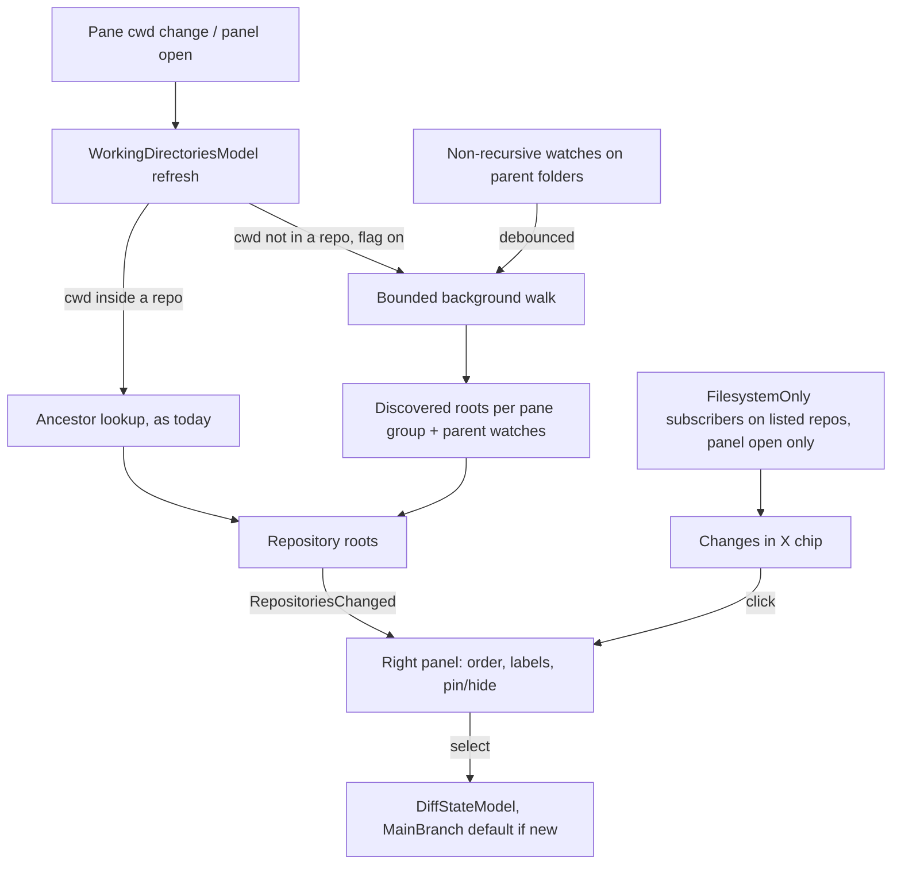

# Multi-Repo Code Review From a Parent Folder - Plan

## Goal Capsule

- **Objective:** A user who runs a coding agent from a folder that holds several git repos can review every change the agent makes in those repos from Warp's code review panel, including changes the agent has already committed, and send review comments back to that agent.
- **Means:** Discovered repos are fed into the panel's existing multi-repo plumbing behind a new feature flag (KTD1, KTD10).
- **Product authority:** This Product Contract, settled with the fork's owner on 2026-10-15. Requirements win on product behavior; KTDs win on mechanism.
- **Execution profile:** Rust, `app/` crate plus `crates/repo_metadata`. Fork branch `feat/tmux-control-mode` in `blaze-rowland/warp`; work lands as commits on that branch (or a branch off it), never touching the user's real repos except to read them during hand testing.
- **Stop conditions:** Stop and ask if discovery cannot be kept off the AI indexing path (KTD3), or if the review-comment target change (R10) would alter behavior for terminals inside a repo.
- **Who finishes:** `ce-work` implements and verifies locally; the user hand-tests in the dev build.

---

## Product Contract

Product Contract preservation: changed: added R10–R12 and resolved the Deferred-to-Planning questions in place — R10–R12 surfaced in planning research and were confirmed by the user at the plan synthesis. R6, R7 and AE4 reworded after document review (user-approved): the panel opens on the remembered repo, and hidden repos sit in a collapsed group.

### Summary

When a tab's working directory is not inside a git repo, the code review panel discovers the repos and worktrees nested under that folder and lists them in its existing repo dropdown. Each repo shows its branch commits plus uncommitted edits relative to main. A "Changes in X" chip offers a jump when a file changes in a repo the user isn't viewing, and the user can pin or hide repos.

### Problem Frame

The user runs Claude Code from an org root (`~/sites/work/eventric`) so one agent can work across backend and frontend repos end to end. That folder is not a git repo; it holds `Backend_Legacy`, `Backend_Mobile`, `Desktop`, `Mobile` and `platform`, and Claude does most of its work in git worktrees under `.claude/worktrees/` (about 20 exist today, e.g. `Backend_Legacy-MON-1091`, `MB-1759`). The main checkouts are usually clean.

Warp resolves a tab's repos by walking *up* from each pane's working directory, so a cwd above several repos yields no repo and the panel says "Diffs only work for git repositories." The user has no way to watch what the agent is changing, which is the review step they rely on. Even when they point the panel at a worktree by hand, the default diff is against HEAD, so anything the agent has already committed is invisible.

### Key Decisions

- **Folder scan, not session tracking.** List every repo and worktree under the folder instead of only those a given agent session touched; session tracking would need per-edit file lists Warp's CLI-agent integration doesn't record, and the user judged it more fragile. Governs R1, R2, R11. (session-settled: user-directed — chosen over "only what this session touched": the user called that "way more finicky and fragile than everything dirty under cwd")
- **Branch-plus-uncommitted diff.** Each discovered repo compares against its main branch so agent commits stay visible, as in a PR. Governs R4. (session-settled: user-directed — chosen over "uncommitted only" and a per-repo default toggle)
- **List everything; let the user pin and hide.** No automatic filtering of stale worktrees. Governs R6, R7. (session-settled: user-directed — chosen over "recently changed first" and "only repos active since the panel opened")
- **Extend the dropdown, follow with a chip.** Reuse the panel's existing multi-repo dropdown and add a non-intrusive jump, rather than a combined multi-repo diff view or auto-switching. Governs R5, R8, R12. (session-settled: user-directed — chosen over a combined collapsible view, a bigger rebuild, and auto-switch, which can yank the user away mid-review)
- **Comments go back to the agent in the parent folder.** A review is only useful if it can reach the agent that made the change. Governs R10. (session-settled: user-approved — proposed at plan synthesis over leaving "send to agent" unavailable for discovered repos)

### Requirements

**Discovery**

- R1. When a tab's working directory is not inside a git repo, the panel lists the git repos and linked worktrees found beneath that directory, hidden directories such as `.claude/worktrees/` included.
- R2. The list stays current as repos or worktrees are created or removed beneath the folder, without the user reopening the panel.
- R3. When the working directory is inside a git repo, the panel behaves exactly as today.
- R11. Discovery never scans the home folder or the filesystem root, stays within a bounded depth and size, and skips dependency and build trees, so it never triggers macOS folder-access prompts or noticeable load.

**What each repo shows**

- R4. A discovered repo's diff defaults to its committed branch changes relative to its main branch plus uncommitted and untracked changes; the existing diff selector can still switch it.
- R5. Dropdown entries show enough to tell worktrees apart: the repo name plus worktree folder or branch.

**Managing the list**

- R6. The user can pin a repo to the top of the dropdown or hide it from the main list, with hidden repos kept in a collapsed "Hidden (N)" group where they can be unhidden; both persist across Warp restarts for that parent folder.
- R7. Dropdown order is pinned repos, then the rest by most recent file change. The panel opens on the tab's remembered repo when it is still listed, otherwise on the first entry.

**Following changes**

- R8. When a file changes in a listed, non-hidden repo other than the one being viewed, the panel shows a "Changes in <repo>" chip; clicking it switches to that repo. The panel never switches on its own.
- R9. Changes in the repo being viewed refresh its diff live, as the panel does today.
- R12. Change tracking for chips runs only while the panel is open; on open, ordering reflects current repo state and no chip is shown for changes made while it was closed.

**Review hand-off**

- R10. "Send review comments to agent" works for a discovered repo when the agent runs in a terminal whose working directory is the parent folder, with file references the agent can open from there.

### Acceptance Examples

- AE1. **Covers R1, R4.** Given cwd `~/sites/work/eventric` and a worktree `.claude/worktrees/MB-1759` with two commits ahead of main and one edited file, when the user opens the panel, `Mobile · MB-1759` is listed and its diff shows the two commits' changes plus the edit.
- AE2. **Covers R3.** Given cwd `~/sites/work/eventric/Desktop`, the panel shows only `Desktop` with today's default diff.
- AE3. **Covers R8.** Given the user is viewing `Backend_Legacy-MON-1091` and Claude edits a file in `Desktop`, a "Changes in Desktop" chip appears and the view does not change until the user clicks it.
- AE4. **Covers R6, R8.** Given `Desktop-MT3-5509` is hidden, edits there produce no chip and it stays out of the main list, under the collapsed "Hidden" group, until unhidden.
- AE5. **Covers R2.** Given the panel is open, when Claude creates a new worktree under `.claude/worktrees/`, it appears in the dropdown without reopening the panel.
- AE6. **Covers R11.** Given a new tab opens at `~`, no scan runs and no folder-access prompt appears.
- AE7. **Covers R10.** Given Claude runs in an `eventric` pane and the user comments on a file in `Mobile · MB-1759`, "Send to agent" targets that pane and Claude can open the commented file.

### Scope Boundaries

- Tracking which files a specific agent session edited.
- Worktrees that live outside the folder, e.g. throwaway worktrees Claude creates under `/private/tmp/...`. Only repos physically beneath the folder appear.
- Remote (SSH) parent folders; discovery is local only.
- The file explorer and global search keep treating the folder as one tree.
- A combined multi-repo diff view.
- AI codebase indexing of discovered repos (KTD3).
- Submodules and repos nested inside another repo: discovery stops at the first repo root.

### Dependencies / Assumptions

- The panel already supports several repos per tab with a dropdown, a remembered per-tab selection and a main-branch diff mode; this work feeds it new repos and changes the default for them.
- Main-branch resolution uses the existing order: `origin/HEAD`, `origin/main`, `origin/master`, `main`, `master`, `develop`, then the current branch (`app/src/util/git.rs` `detect_main_branch`). A repo sitting on main therefore shows the same changes as a HEAD diff.
- Review comments already carry absolute file paths when sent, so an agent in the parent folder can open them; the prompt's bare `git diff` hints (`app/src/terminal/cli_agent.rs` `build_review_prompt`) do need the repo named, which U7 handles.

### Sources / Research

- Repo list source: `app/src/pane_group/working_directories.rs` (`refresh_working_directories_for_pane_group`, ancestor-only root lookup via `DetectedRepositories::get_root_for_path` in `crates/repo_metadata/src/repositories.rs`).
- Existing dropdown and per-tab selection: `app/src/workspace/view/right_panel.rs` (`CodeReviewState`, `render_repo_dropdown`, `ensure_code_review_view_exists`, `review_terminal_status`).
- Non-repo empty state and diff modes: `app/src/code_review/code_review_view.rs`, `app/src/code_review/diff_state/mod.rs` (`DiffMode::MainBranch`), `app/src/code_review/diff_state/local.rs`.
- CLI-agent session context holds no edited-file list: `app/src/terminal/cli_agent_sessions/mod.rs`.

---

## Planning Contract

### Key Technical Decisions

- KTD1. **Discovered repos join the repository roots, never the display roots.** `WorkingDirectoriesModel` keeps a per-pane-group set of discovered roots and chains it into the repo roots before `set_paths`, so only `RepositoriesChanged` fires and the file tree and search (which listen to `DirectoriesChanged`) are untouched. Each discovered root maps to the terminal whose cwd produced it, because `ensure_code_review_view_exists` refuses to build a view for a root with no terminal. Precedent: `register_remote_repo`. Covers R1, R3.
- KTD2. **Bounded background walk, modeled on `crates/build_cache/src/discovery.rs`.** `walkdir` with: max depth 3 below the cwd (enough for `.claude/worktrees/<name>`), no symlink following, a visited-directory cap, a skip list (`node_modules`, `target`, `dist`, `build`, `.venv`, `vendor`, `Library`, `.cache`, `.Trash`), and `skip_current_dir` at the first directory containing a `.git` dir or file. No scan when the cwd is `$HOME`, any ancestor of `$HOME` (such as `/Users`), `/`, `/Volumes` or a volume root. `ignore::WalkBuilder` was rejected because it skips hidden directories by default. Covers R1, R11.
- KTD3. **Discovery stays off the AI indexing path.** Registering roots through `detect_possible_local_git_repo` emits `DetectedGitRepo`, which triggers codebase, outline and file-tree indexing for every repo. The scan records roots directly. When the user selects a discovered repo, its diff model is created with a new `RepoDetectionSource::DiscoveredRepoReview`, and the indexing subscribers skip that source. A repo the user `cd`s into is still indexed as today. Covers R1.
- KTD4. **Main-branch default applies only when the panel creates the diff model for a discovered repo.** `DiffStateModel` is shared per repo across tabs. If the model already exists because another tab sits inside that repo, its mode is left alone; a user's later mode change sticks to the shared model as it does today. The model records whether its mode is still the untouched discovery default; when the repo becomes cwd-derived in any pane group while that marker is set, the mode resets to `Head` and the marker clears, so a tab that `cd`s into a viewed worktree still gets today's default. Accepted limitation (user-approved at document review): when another tab already sits inside a discovered repo, the parent-folder panel shows that shared model's current mode until the user switches the selector; per-tab diff modes are out of scope. Covers R3, R4.
- KTD5. **Rescans are driven by non-recursive watches on the folders the walk passed through.** These are the non-repo directories above the repos (e.g. `eventric`, `eventric/.claude`, `eventric/.claude/worktrees`) — a handful, never repo internals. A debounced rescan also runs on cwd change and panel open. Covers R2, R12.
- KTD6. **Chips come from lightweight filesystem subscribers, not diff models.** Non-viewed repos have no live diff model (its refresh is off when the view closes), so each listed, non-hidden discovered repo other than the one being viewed gets a `RepositoryWatchMode::FilesystemOnly` subscriber while the panel is open. Handles come from registering each repo directly with `DirectoryWatcher::add_directory_with_git_dir` (passing a linked worktree's external git dir), which emits no `DetectedRepositoriesEvent`; they are released when the panel closes. The usual `DetectedRepositories::get_local_watched_repo_for_path` route returns nothing for scan-recorded repos, and registering through detection would index them (KTD3). Events under `.git/` and gitignored paths are dropped. One chip at a time names the most recent repo; it is replaced by a newer change and cleared when that repo is viewed. Covers R8, R12.
- KTD7. **Pin/hide live in a private desktop-only settings map keyed by the canonicalized parent folder.** Follow `PluginInstallChipDismissedMap` in `app/src/settings/ai.rs` (`SyncToCloud::Never`, `private: true`), placed in `app/src/settings/code.rs`. Canonicalizing handles case-insensitive APFS spellings (`~/sites` vs `~/Sites`) and `/tmp` vs `/private/tmp`. Entries survive worktree deletion, so a worktree recreated at the same path keeps its pin. Covers R6.
- KTD8. **Ordering and labels are pure functions with a frozen order while the dropdown is open.** Order: pinned (in pin order), then every other listed repo, cwd-derived and discovered alike, by last change time, newest first. Hidden repos are excluded. Last change time starts from the newest of: the repo's git index and `HEAD` reflog mtimes (for linked worktrees, resolved through the gitdir) and the top-level working-tree entry mtimes read during the scan. KTD6 events bump it. Labels for linked worktrees are `<main repo name> · <worktree folder>`, with the main repo name taken from the worktree's common git dir. Dropdown selection switches from display name to action, so duplicate labels cannot select the wrong repo. Covers R5, R7.
- KTD9. **Review-target check accepts the discovery parent.** `review_terminal_status` treats a local terminal as in-repo when its cwd is inside the repo (today) or equals the folder the repo was discovered under. Covers R10.
- KTD10. **New `FeatureFlag::MultiRepoCodeReview` enabled by a `multi_repo_code_review` cargo feature,** mirroring `TmuxControlMode` (`crates/warp_features/src/lib.rs`, `app/src/features.rs`, `app/Cargo.toml`). Mirror only the cargo-feature gate in `app/src/features.rs`; do not add it to `DOGFOOD_FLAGS`, which every dev build enables. There's no user setting, so no Command Palette entry is needed. The scan is gated in `WorkingDirectoriesModel`, and the pin/hide UI and chip are gated in the right panel. With the flag off, behavior is identical to today.

### High-Level Technical Design

Transitions for a tab whose cwd moves:

| From | To | List | Selection |
|---|---|---|---|
| Parent folder | Repo under it | Only that repo (R3) | That repo |
| Repo | Its parent folder | Discovered set | Kept if still listed, else first entry |
| Parent folder | `$HOME` | Empty-state message | None |
| Mixed panes (one in parent, one in a repo) | — | Union, deduped by canonical path | Kept if listed |

### Assumptions

- `notify` non-recursive watches are cheap enough to hold on a handful of parent folders per tab (the home-directory watcher already does this).
- A repo's `.git/index` and `HEAD` reflog mtimes are a good enough recency proxy at scan time; it does not need to match git status exactly.

---

## Implementation Units

### U1. Feature flag

- **Goal:** Add the `MultiRepoCodeReview` flag, off unless the cargo feature is built.
- **Requirements:** KTD10.
- **Dependencies:** none.
- **Files:** `crates/warp_features/src/lib.rs`, `app/src/features.rs`, `app/Cargo.toml`.
- **Approach:** Follow `.claude/skills/add-feature-flag/SKILL.md` and the `TmuxControlMode` wiring.
- **Test expectation:** none -- flag plumbing only; exercised by later units.
- **Verification:** `cargo check -p warp --features multi_repo_code_review` compiles, and so does a build without the feature.

### U2. Repo discovery walk

- **Goal:** A function that, given a local folder, returns the git repos and linked worktrees beneath it within the bounds of KTD2, plus the non-repo directories it walked (for KTD5).
- **Requirements:** R1, R11; KTD2.
- **Dependencies:** none.
- **Files:** `crates/repo_metadata/src/discovery.rs` (new), `crates/repo_metadata/src/discovery_tests.rs` (new), `crates/repo_metadata/src/lib.rs`.
- **Approach:**
  1. Refuse the KTD2 roots up front.
  2. Walk with the depth, visited-directory cap, skip list and no-symlink rules of KTD2, recording a hit and skipping descent at any directory with a `.git` dir or a `.git` file containing `gitdir:` (reuse `find_git_repo`'s parsing).
  3. Drop a worktree whose gitdir no longer exists, and one whose `HEAD` doesn't resolve yet (half-created).
  4. Return canonical paths, deduped, plus each linked worktree's main-repo name from its common dir, plus the visited non-repo directories and a truncated flag.
  5. Unreadable directories are skipped with one debug log.
- **Patterns to follow:** `crates/build_cache/src/discovery.rs`; worktree parsing in `crates/repo_metadata/src/repositories.rs`.
- **Test scenarios:**
  - A temp folder with two main repos and `.claude/worktrees/A` (a linked worktree of the first) returns three roots, with `A` labeled by the first repo's name.
  - A repo containing `node_modules/pkg/.git` returns only the outer repo.
  - A repo nested inside another repo (submodule-style) is not returned.
  - A folder at depth 4 holding a repo is not returned; the result is not marked truncated for depth.
  - A symlink to a repo elsewhere is not followed.
  - A chmod-000 subdirectory is skipped and the rest of the scan still returns.
  - A worktree whose `.git` file points at a missing gitdir is skipped.
  - Passing `$HOME`, its parent, `/` or `/Volumes` returns nothing without walking.
  - Exceeding the visited-directory cap returns partial results with truncated set.
  - The visited non-repo directories include `.claude` and `.claude/worktrees` but no directory inside a repo.
- **Verification:** `cargo nextest run -p repo_metadata -E 'test(discovery)'` passes.

### U3. Working-directories integration

- **Goal:** Feed discovered repos into each pane group's repository roots, keep them current, and keep them off the indexing path.
- **Requirements:** R1, R2, R3, R4, R11, R12; KTD1, KTD3, KTD4, KTD5.
- **Dependencies:** U1, U2.
- **Files:** `app/src/pane_group/working_directories.rs`, `app/src/pane_group/working_directories_tests.rs`, `crates/repo_metadata/src/repositories.rs`, `app/src/code_review/diff_state/local.rs`, `app/src/code_review/diff_state/mod.rs`, plus the indexing subscribers that react to `DetectedGitRepo` (`app/src/ai/persisted_workspace.rs`, `app/src/ai/outline/native.rs`, `crates/repo_metadata/src/local_model.rs`).
- **Approach:**
  1. Keep a per-pane-group cache of discovery results keyed by canonical cwd. During refresh (which runs on every pane-group state change), chain in the cached roots for each local cwd with no ancestor repo (flag on). Spawn the U2 walk off the main thread only when that cwd has no cache entry or a KTD5 trigger fires (parent-folder watch event, panel open), debounced. On completion, update the cache and the parent-folder mapping, then run the same diff-and-emit as `register_remote_repo`.
  2. Chain discovered roots into the repo roots on every refresh, since `set_paths` replaces the set. Map each to its source terminal in the root-to-terminal map.
  3. Drop a pane group's discovered roots when no pane's cwd still produces them, and when the pane group closes.
  4. Hold non-recursive watches on the walk's visited directories; on a create/remove event, debounce and rescan that pane group. Release watches with the discovery entry.
  5. Add `RepoDetectionSource::DiscoveredRepoReview`. When the panel asks for a diff model for a discovered root and none exists, create it with that source and `DiffMode::MainBranch`. Teach the indexing subscribers to skip that source.
  6. Expose discovered-root metadata (parent folder, label parts, recency seed) for U4–U7.
- **Patterns to follow:** `register_remote_repo` and `emit_repositories_changed` in `working_directories.rs`; the existing `setup_repo` test helper.
- **Test scenarios:**
  - Covers AE1. A pane whose cwd is a temp parent of two repos produces both roots in `RepositoriesChanged`, and `DirectoriesChanged` still lists only the parent folder.
  - Covers AE2. A pane whose cwd is inside one of those repos produces only that repo, and no scan runs.
  - A pane group with one pane in the parent and one inside a repo gets the union, deduped.
  - Changing the cwd from the parent to `$HOME` empties the discovered set and releases its watches.
  - Covers AE5. Creating a new worktree under a watched `.claude/worktrees` adds it after the debounce. Removing one drops it.
  - A diff model created for a discovered root defaults to `MainBranch`. A model that already existed for a cwd-derived repo keeps `Head`.
  - Selecting a discovered repo does not emit an event that triggers indexing (assert the detection source passed through).
  - With the flag off, a parent-folder cwd produces no repos (today's behavior).
  - Two refreshes with an unchanged parent-folder cwd start only one walk.
  - Covers KTD4. After viewing a discovered repo (mode `MainBranch`), a pane `cd`s into it and its model resets to `Head`. A model the user switched by hand keeps the user's mode.
- **Verification:** `cargo nextest run -p warp -E 'test(working_directories)'` passes, and existing tests in that file are unchanged and green.

### U4. Pin/hide storage, ordering and labels

- **Goal:** Persist pin/hide per parent folder and compute dropdown order and labels as pure functions.
- **Requirements:** R5, R6, R7; KTD7, KTD8.
- **Dependencies:** U3.
- **Files:** `app/src/settings/code.rs`, `app/src/code_review/repo_list.rs` (new), `app/src/code_review/repo_list_tests.rs` (new), `app/src/code_review/mod.rs`.
- **Approach:**
  1. Add a private, desktop-only settings map from canonical parent path to `{ pinned: ordered list, hidden: set }`, with accessor and mutator in the style of `PluginInstallChipDismissedMap`.
  2. In `repo_list.rs`, add a pure ordering function over (pinned, hidden, cwd-derived in focus order, discovered with recency) and a label function for main checkouts and linked worktrees.
- **Test scenarios:**
  - Pinned repos come first in pin order, then cwd-derived repos, then discovered repos newest-first.
  - Covers AE4. A hidden repo is absent from the ordered list.
  - Pinning a hidden repo unhides it.
  - A worktree label is `Mobile · MB-1759`. A main checkout label is `Mobile`.
  - Two worktrees named `api` under different repos get distinct labels.
  - Pin and hide keyed from `~/sites/x` are found again from `~/Sites/x` after canonicalization.
  - A pinned path that no longer exists is ignored in ordering but kept in storage.
- **Verification:** `cargo nextest run -p warp -E 'test(repo_list)'` passes.

### U5. Right panel dropdown

- **Goal:** Show discovered repos with the new order, labels and pin/hide controls, without disturbing the cwd-inside-repo experience.
- **Requirements:** R3, R5, R6, R7; KTD8, KTD10.
- **Dependencies:** U3, U4.
- **Files:** `app/src/workspace/view/right_panel.rs`, `app/src/view_components/dropdown.rs` (only if rich items need a small extension).
- **Approach:**
  1. Build the dropdown from U4's order and labels, using rich menu items (`set_rich_items`). Each discovered row carries pin and hide icon actions (labels "Pin <repo>" / "Hide <repo>", reachable from the focused row by keyboard). If a row allows only one right-side action, the second goes in a row context submenu. Hidden repos sit in a collapsed "Hidden (N)" group at the bottom with an unhide action. Show these controls only for discovered sets and only with the flag on.
  2. Select by action rather than display name.
  3. Freeze the order while the dropdown is open, and apply the latest order on close.
  4. Per R7: keep the saved per-tab selection when it is still listed. When the selected repo becomes hidden or disappears, select the first entry.
  5. Panel states for a discovered set: while the first walk is running, the dropdown shows a "Scanning for repositories…" placeholder; when the walk was truncated, a one-line "Showing partial results" note sits at the end of the dropdown; when every repo is hidden, the body says so and points to the hidden list. Keep today's empty-state message when the walk found no repos.
- **Patterns to follow:** `app/src/terminal/view/ambient_agent/auth_secret_selector.rs` for right-side icon actions; `MenuItem::Header` in `app/src/menu.rs`.
- **Test scenarios:**
  - Test expectation for rendering: hand-checked in the dev build (the full view harness hangs on this machine; see Verification Contract). Ordering, hidden filtering and selection fallback are covered through U4's pure functions plus a selection-fallback helper.
  - Selection fallback: given the saved selection hidden, the helper returns the first ordered entry.
  - Selection fallback: given the saved selection still listed, the helper keeps it.
- **Verification:** In the dev build with cwd `~/sites/work/eventric`, the dropdown lists the repos and worktrees with `Repo · worktree` labels; pin moves a repo to the top and survives a restart; hide removes it and it reappears under "Hidden".

### U6. Changes chip

- **Goal:** Tell the user when a non-viewed repo changes and let them jump there.
- **Requirements:** R8, R9, R12; KTD6.
- **Dependencies:** U3, U5.
- **Files:** `app/src/workspace/view/right_panel.rs`, `app/src/code_review/repo_list.rs`, `app/src/code_review/repo_list_tests.rs`.
- **Approach:**
  1. While the panel is open on a discovered set, attach a `FilesystemOnly` repository subscriber to each listed, non-hidden repo except the one being viewed, and detach on close or when the repo is hidden.
  2. Run events through a pure filter that drops `.git/` paths and gitignored paths.
  3. Store one pending chip (the repo plus its time) and bump that repo's recency for the next ordering.
  4. Render the chip as a focusable button in the header's right section before the dropdown, middle-truncating long repo labels with the full text in a tooltip. Clicking it dispatches a new `RightPanelAction::JumpToRepo`, which selects that repo and clears the chip. Viewing that repo by any route also clears it.
  5. Remove the unused `did_focused_repo_change` stub if the chip state replaces it.
- **Patterns to follow:** `RepositorySubscriber` in `crates/repo_metadata/src/repository.rs`; header `right_section` in `right_panel.rs`.
- **Test scenarios:**
  - Covers AE3. Given the viewed repo is A and an event arrives for a tracked file in B, the chip rule yields "Changes in B".
  - Given an event only under `B/.git/`, no chip is shown.
  - Given an event for a gitignored path in B, no chip is shown.
  - Given events for B then C, the chip names C.
  - Covers AE4. Given an event in a hidden repo, no chip is shown.
  - Given an event in the viewed repo, no chip is shown.
  - Viewing B clears a pending B chip.
  - Opening the panel on a discovered set registers chip watchers without emitting `DetectedGitRepo`.
- **Verification:** The chip-rule tests pass. In the dev build, editing a file in another worktree shows the chip within about a second, and clicking it switches without the panel moving on its own.

### U7. Review comments reach the parent-folder agent

- **Goal:** Make "send review comments to agent" work for discovered repos.
- **Requirements:** R10; KTD9.
- **Dependencies:** U3.
- **Files:** `app/src/workspace/view/right_panel.rs`, `app/src/terminal/cli_agent.rs` (`build_review_prompt` and its tests), plus a test file for the extracted check: `app/src/workspace/view/right_panel_tests.rs` (new) or `app/src/code_review/repo_list_tests.rs`.
- **Approach:**
  1. Extract the cwd-versus-repo check in `review_terminal_status` into a pure helper.
  2. Have the helper also accept a cwd equal to the repo's discovery parent folder (from U3 metadata).
  3. In `build_review_prompt`, when the review's repo root is not an ancestor of the target terminal's cwd, name the repo in the git hints: `git -C <repo root> diff <merge-base>` in main-branch mode, `git -C <repo root> diff HEAD` in head mode, instead of bare `git diff`. Confirm the file references stay absolute.
- **Test scenarios:**
  - A terminal cwd inside the repo is accepted (today's behavior).
  - Covers AE7. A terminal cwd equal to the discovery parent of the selected repo is accepted.
  - A terminal cwd in an unrelated folder is rejected with `SessionOutsideSelectedRepo`.
  - A terminal cwd in the parent folder is rejected for a repo that was *not* discovered from that folder.
  - The review prompt for a discovered repo sent to a parent-folder terminal uses `git -C <repo root>` hints. A prompt for a terminal inside the repo is unchanged.
- **Verification:** Helper tests pass. In the dev build, with Claude running in an `eventric` pane, sending a comment on a worktree file delivers it to that pane and Claude can open the file.

---

## Verification Contract

| Check | Command or method | Applies to |
|---|---|---|
| Discovery unit tests | `cargo nextest run -p repo_metadata -E 'test(discovery)'` | U2 |
| App unit tests | `cargo nextest run -p warp --features multi_repo_code_review -E '(test(working_directories) \| test(repo_list) \| test(right_panel)) & !test(view::tests)'` | U3–U7 |
| Regression | `cargo nextest run -p warp -E '(test(working_directories) \| test(code_review)) & !test(view::tests)'` without the feature | U3, U5 |
| Lint | `cargo clippy -p warp -p repo_metadata --all-targets --tests --features multi_repo_code_review -- -D warnings` | all |
| Format | `./script/format`, run once at the end | all |
| Hand test | Rebuild with `./script/run --features tmux_control_mode,multi_repo_code_review`; open a tab at `~/sites/work/eventric` and check AE1–AE7 | U5–U7 |

The full view test harness (`workspace::view::tests`, `terminal::view::tests`) hangs on this development machine even on unmodified master, so view-level behavior is covered by pure-function tests plus hand testing. Don't run a full presubmit.

---

## Definition of Done

- Every unit's tests pass with the feature on, existing `working_directories` and `code_review` tests pass with it off, and clippy is clean.
- With the flag off, a parent-folder cwd behaves exactly as before (empty-state message), verified by test.
- The hand test confirms AE1–AE7 in the dev build against `~/sites/work/eventric`, without writing to any of the user's repos.
- No dead code from abandoned approaches remains in the diff. Experimental scan variants, debug logging and unused helpers are removed.
- Commits touch only this feature's files and end with the session's Co-Authored-By line.
